import Details from '@theme/Details';

<br/>
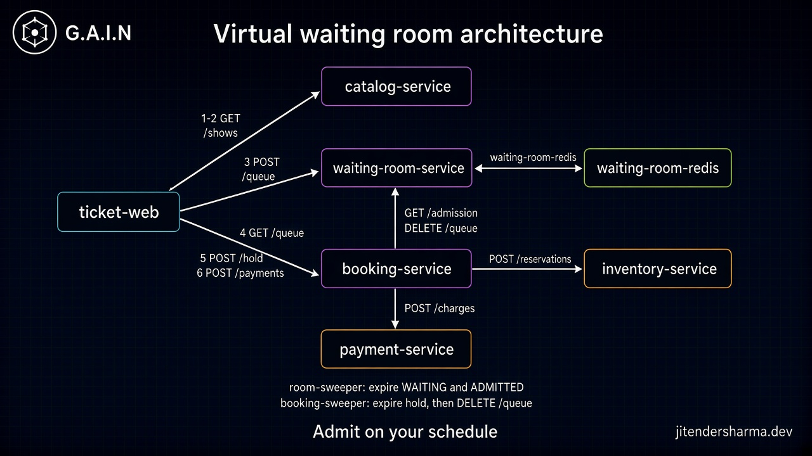

# Virtual waiting room: High-level architecture

Detailed architecture for [Virtual Waiting Room: Absorbing the Open-Second Stampede](/insights/virtual-waiting-room-system-design): services, APIs, store keys, and the request path. The parent insight keeps the claim and the tradeoffs.

**Parent insight:** [Virtual Waiting Room: Absorbing the Open-Second Stampede](/insights/virtual-waiting-room-system-design)

## Problem statement

About 2,000,000 browsers and scripts arrive in the first 60 seconds of an open-second sale. Scarce units are in the hundreds to low thousands. Booking, inventory, and payments can absorb about 2,000-3,000 concurrent bookers. If every arrival can call `POST /shows/{showId}/hold`, auth, booking, inventory, and payments melt in the same second. The waiting room must turn that stampede into an ordered wait, admit a trickle, and shed when even waiting is too expensive.

## Assumptions

- Show details live on `catalog-service`. The user lists shows (`GET /shows`), opens one (`GET /shows/{showId}`), then taps **Enter the queue**. That tap is `POST /shows/{showId}/queue`. Catalog is CDN-cached. It is not the line.
- Sale start enables `POST /shows/{showId}/queue`. It does not raise the admit rate.
- Admit rate is tied to the downstream token pool (about 2,000-3,000 concurrent bookers), not to wall-clock open. A slot frees when booking completes the user, the wait expires, or booking reports a dead hold. The arrival ticket never rewinds.
- `waiting-room-service` binds a queue to a pre-auth `userId`. One active wait per user per `showId`. A refresh must not mint a new `queueId`.
- `booking-service` is the admission gate for `POST /shows/{showId}/hold` and `POST /shows/{showId}/payment`. It asks `waiting-room-service` `GET /shows/{showId}/admission`. After a successful charge, or when a hold lease expires, it calls `DELETE /shows/{showId}/queue`. The room does not watch inventory. If the room is down, checkout fails closed. Booking never writes waiting-room Redis. `userId` is on the caller, not in the path.
- Waiters are sharded (`hash(userId) % N` or by sale section). Position is an estimate (`ticket - promotedCursor`), not exact worldwide `ZRANK`.
- Default ordering is authenticated FIFO with abuse demotion. Lottery is the fallback when identity is weak.
- The room hard cap is sized from Redis memory and status RPS before the event (example: 500,000 waiters). Beyond that, `SHED`.
- Status polls are jittered. The server dictates `pollAfterMs`. Far from the head: about 10s. Near the head: about 2s. Each poll refreshes membership TTL. No poll before TTL: `EXPIRED`.
- Two TTLs. `WAITING`: a few missed polls (about 30-60s). `ADMITTED`: a booking window (minutes). Redis key expiry is not enough. **room-sweeper** (a loop inside `waiting-room-service`) must `ZREM`, delete the user binding, and `DECR` admitted.
- A hold lease is a third TTL, on inventory, started at `POST /shows/{showId}/hold`. Size it inside the remaining `ADMITTED` window. One live hold per `userId` per `showId`. When it expires, booking returns the seats and tells the room (`DELETE /shows/{showId}/queue`). That is how the admit slot opens. One shot. No retry **Hold**.
- Remaining tickets live on `inventory-service`. The waiting room never reads them. Catalog may show a cached hint on the show page. The live count is the atomic `DECR` on `POST /reservations`. `GET /queue` must not carry remaining.
- Queue position is not a seat. The room does not allocate inventory, take payment, or prove bot fairness.

## Service diagram

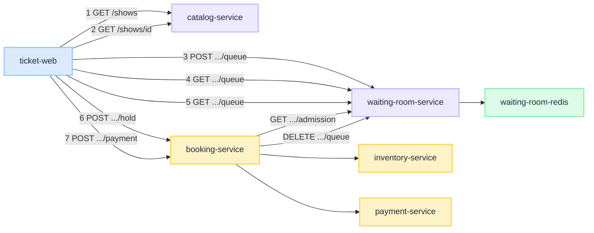
<br/>

## Per-service role, APIs, and store keys

### ticket-web

**Role.** Browser client. Loads `GET /shows`, opens one show, and only then shows **Enter the queue**. After join it honors `pollAfterMs`, shows a position estimate, and keeps **Hold** disabled until `GET /shows/{showId}/queue` returns `ADMITTED`. It keeps polling after that so the booking-window TTL stays alive. After a hold, **Pay** is on until `expiresAt`. Then both buttons go off. Remaining tickets, if shown, come from catalog's cached `remainingHint`, never from `GET /queue`. It does not invent a queue id on refresh.

**APIs.** None exposed. It calls catalog, waiting-room, and booking.

**Store keys.** None.

### catalog-service

**Role.** Holds show details: title, venue, when, poster, ticket types. Serves the list and the individual page. CDN / edge cache. A slow poller copies `remainingHint` from inventory `GET /availability`. It does not assign a queue number, sit on the book path, or answer live remaining.

**APIs.**

| Method | Path | Caller | Returns / effect |
| --- | --- | --- | --- |
| `GET` | `/shows` | ticket-web | Paginated list of shows (`showId`, title, when, thumbnail) |
| `GET` | `/shows/{showId}` | ticket-web | One show plus cached `remainingHint`. Page includes **Enter the queue** |

<Details summary="GET /shows (JSON)">

```json
{
  "request": {
    "method": "GET",
    "path": "/shows",
    "query": { "page": 1, "pageSize": 20 }
  },
  "response": {
    "data": [
      {
        "showId": "sh_9k2",
        "title": "Arena night",
        "venue": "Docklands",
        "startsAt": "2026-08-04T19:00:00Z",
        "thumbnailUrl": "https://cdn.example/sh_9k2.jpg"
      }
    ],
    "pagination": {
      "page": 1,
      "pageSize": 20,
      "totalItems": 12,
      "totalPages": 1
    }
  }
}
```

</Details>

<Details summary="GET /shows/{showId} (JSON)">

```json
{
  "request": {
    "method": "GET",
    "path": "/shows/sh_9k2"
  },
  "response": {
    "showId": "sh_9k2",
    "title": "Arena night",
    "venue": "Docklands",
    "startsAt": "2026-08-04T19:00:00Z",
    "description": "General admission on-sale.",
    "posterUrl": "https://cdn.example/sh_9k2-poster.jpg",
    "ticketTypes": [
      { "ticketTypeId": "ga", "label": "GA", "priceCents": 8900, "remainingHint": 400 }
    ]
  }
}
```

</Details>

**Store keys.** Catalog DB / CDN cache. Not waiting-room Redis. The room may keep a tiny `show:{showId}:config` (open window, cap, `pollAfterMs`) copied at publish. That is not show copy. `remainingHint` is a slow copy from inventory `GET /availability`, not a live counter.

### waiting-room-service

**Role.** Assigns queue ids, binds one wait per `userId` per `showId`, answers cheap queue reads, promotes the head while `admitted` is under the token pool, answers booking's admission check, releases a slot on complete or expire, and returns `SHED` when the room is full. A **room-sweeper** loop inside this service expires overdue `WAITING` and `ADMITTED` hashes. It does not decrement inventory, take payment, or run CAPTCHA on every poll.

**APIs.**

| Method | Path | Caller | Returns / effect |
| --- | --- | --- | --- |
| `POST` | `/shows/{showId}/queue` | ticket-web | **Enter the queue**. Create or reuse. `userId` from auth. `SHED` when full |
| `GET` | `/shows/{showId}/queue` | ticket-web | This user's place. Position, ETA, state. UI hint only |
| `GET` | `/shows/{showId}/admission` | booking-service | `{ isAllowed, state }`. `userId` from the caller |
| `DELETE` | `/shows/{showId}/queue` | booking-service | After a successful charge (`COMPLETED`) or a dead hold (`EXPIRED`). Drop the wait, free one admit slot |

<Details summary="POST /shows/{showId}/queue (JSON)">

```json
{
  "request": {
    "method": "POST",
    "path": "/shows/sh_9k2/queue",
    "body": {}
  },
  "response": {
    "queueId": "q_184",
    "positionEstimate": 42131,
    "pollAfterMs": 10000,
    "state": "WAITING"
  }
}
```

</Details>

<Details summary="GET /shows/{showId}/queue (JSON)">

```json
{
  "request": {
    "method": "GET",
    "path": "/shows/sh_9k2/queue"
  },
  "response": {
    "queueId": "q_184",
    "state": "WAITING",
    "positionEstimate": 18420,
    "etaSeconds": 720,
    "pollAfterMs": 10000
  }
}
```

</Details>

<Details summary="GET /shows/{showId}/queue when admitted (JSON)">

```json
{
  "request": {
    "method": "GET",
    "path": "/shows/sh_9k2/queue"
  },
  "response": {
    "queueId": "q_184",
    "state": "ADMITTED",
    "positionEstimate": 0,
    "etaSeconds": 0,
    "pollAfterMs": 2000
  }
}
```

</Details>

<Details summary="GET /shows/{showId}/queue after expire (JSON)">

```json
{
  "request": {
    "method": "GET",
    "path": "/shows/sh_9k2/queue"
  },
  "response": {
    "queueId": "q_184",
    "state": "EXPIRED",
    "positionEstimate": null,
    "etaSeconds": null,
    "pollAfterMs": 0
  }
}
```

</Details>

<Details summary="GET /shows/{showId}/admission (JSON)">

```json
{
  "request": {
    "method": "GET",
    "path": "/shows/sh_9k2/admission"
  },
  "response": {
    "isAllowed": true,
    "state": "ADMITTED"
  }
}
```

</Details>

<Details summary="GET /shows/{showId}/admission after expire (JSON)">

```json
{
  "request": {
    "method": "GET",
    "path": "/shows/sh_9k2/admission"
  },
  "response": {
    "isAllowed": false,
    "state": "EXPIRED"
  }
}
```

</Details>

<Details summary="DELETE /shows/{showId}/queue (JSON)">

```json
{
  "request": {
    "method": "DELETE",
    "path": "/shows/sh_9k2/queue"
  },
  "response": {
    "state": "COMPLETED"
  }
}
```

</Details>

<Details summary="DELETE /shows/{showId}/queue after hold expire (JSON)">

```json
{
  "request": {
    "method": "DELETE",
    "path": "/shows/sh_9k2/queue",
    "body": { "reason": "hold_expired" }
  },
  "response": {
    "state": "EXPIRED"
  }
}
```

</Details>

**Store keys.** Owns `waiting-room-redis`. Keys are per `showId`. Membership has a TTL so abandoned tabs leave. Shard waiters; do not put two million in one list.

| Key / structure | Type | Holds | Operations |
| --- | --- | --- | --- |
| `show:{showId}:ticket` | string / `INCR` | Arrival ticket | Mint on enter |
| `show:{showId}:wait:{shard}` | sorted set | Waiters scored by ticket (FIFO) or lottery | Promote from the head |
| `show:{showId}:q:{queueId}` | hash | userId, expiry, state | Bind one wait; poll refreshes expiry; sweeper sets `EXPIRED` |
| `show:{showId}:user:{userId}` | string | Active `queueId` for this user | POST /queue reuses it; admission lookup uses it; DELETE /queue deletes it |
| `show:{showId}:promoted` | string | Promotion cursor | ETA: `ticket - promotedCursor`. Advances on promote, not on complete |
| `show:{showId}:admitted` | string / counter | Occupied admit slots | `INCR` on promote, `DECR` on complete, hold expiry, or expire of `ADMITTED` |
| `show:{showId}:status:{queueId}` | string, short TTL | Cached status payload | Serve polls without hitting booking |
| `show:{showId}:config` | hash | Open window, cap, `pollAfterMs` | Copied from catalog at publish. Not show copy |

### waiting-room-redis

**Role.** Shared line for every room replica: fast `INCR`, TTLs, and cheap rank-style reads. It is not inventory.

**APIs.** None public. Talked to only by `waiting-room-service`.

**Store keys.** Same structures as above. Event A and Event B never share a key prefix.

### booking-service

**Role.** Hold and pay. Before inventory or charge, it asks `waiting-room-service` `GET /shows/{showId}/admission`. It owns the hold clock. A **booking-sweeper** loop inside this service expires overdue holds, returns seats, and calls `DELETE /shows/{showId}/queue` so the room can free the admit slot. Booking still needs the active-token plane; the room only answers who may attempt.

**APIs.**

| Method | Path | Caller | Returns / effect |
| --- | --- | --- | --- |
| `POST` | `/shows/{showId}/hold` | ticket-web | Calls admission, then `POST /reservations` if `isAllowed`. Reuses a live hold |
| `GET` | `/shows/{showId}/hold` | ticket-web | This user's hold. `HELD` or `EXPIRED`. `userId` from the caller |
| `POST` | `/shows/{showId}/payment` | ticket-web | Admission plus a live hold, then `POST /charges`, then `DELETE /shows/{showId}/queue` |

<Details summary="POST /shows/{showId}/hold (JSON)">

```json
{
  "request": {
    "method": "POST",
    "path": "/shows/sh_9k2/hold",
    "body": { "ticketTypeId": "ga", "quantity": 2 }
  },
  "response": {
    "holdId": "hld_441",
    "showId": "sh_9k2",
    "expiresAt": "2026-08-04T19:12:00Z",
    "state": "HELD"
  }
}
```

</Details>

<Details summary="POST /shows/{showId}/hold sold out (JSON)">

```json
{
  "request": {
    "method": "POST",
    "path": "/shows/sh_9k2/hold",
    "body": { "ticketTypeId": "ga", "quantity": 2 }
  },
  "response": {
    "remaining": 0,
    "state": "SOLD_OUT"
  }
}
```

</Details>

<Details summary="GET /shows/{showId}/hold (JSON)">

```json
{
  "request": {
    "method": "GET",
    "path": "/shows/sh_9k2/hold"
  },
  "response": {
    "holdId": "hld_441",
    "showId": "sh_9k2",
    "expiresAt": "2026-08-04T19:12:00Z",
    "state": "HELD"
  }
}
```

</Details>

<Details summary="GET /shows/{showId}/hold after expire (JSON)">

```json
{
  "request": {
    "method": "GET",
    "path": "/shows/sh_9k2/hold"
  },
  "response": {
    "holdId": "hld_441",
    "showId": "sh_9k2",
    "expiresAt": "2026-08-04T19:12:00Z",
    "state": "EXPIRED"
  }
}
```

</Details>

<Details summary="POST /shows/{showId}/payment (JSON)">

```json
{
  "request": {
    "method": "POST",
    "path": "/shows/sh_9k2/payment",
    "body": { "holdId": "hld_441" }
  },
  "response": {
    "paymentId": "pay_882",
    "holdId": "hld_441",
    "state": "PAID"
  }
}
```

</Details>

<Details summary="POST /shows/{showId}/payment after hold expire (JSON)">

```json
{
  "request": {
    "method": "POST",
    "path": "/shows/sh_9k2/payment",
    "body": { "holdId": "hld_441" }
  },
  "response": {
    "holdId": "hld_441",
    "state": "EXPIRED"
  }
}
```

</Details>

**Store keys.** None in the waiting-room Redis. Booking state lives on the booking plane.

### inventory-service

**Role.** Seat counter. Owns remaining per `showId` + `ticketTypeId`. Called by booking on hold, and by a slow catalog poller for the show-page hint. The waiting room never talks to it. Clients do not call it.

**APIs.** No public client API.

| Method | Path | Caller | Returns / effect |
| --- | --- | --- | --- |
| `GET` | `/availability` | catalog-service (slow poller), booking-service | Remaining and held per ticket type. Not for 2M browsers |
| `POST` | `/reservations` | booking-service | Atomic `DECR` remaining, mint a lease. `SOLD_OUT` if remaining is too low. Sweeper `INCR`s remaining when `expiresAt` elapses |
| `GET` | `/reservations/{reservationId}` | booking-service | `RESERVED` or `EXPIRED`. Booking checks this before charge |

<Details summary="GET /availability (JSON)">

```json
{
  "request": {
    "method": "GET",
    "path": "/availability",
    "query": { "showId": "sh_9k2" }
  },
  "response": {
    "showId": "sh_9k2",
    "ticketTypes": [
      { "ticketTypeId": "ga", "remaining": 412, "held": 88 }
    ]
  }
}
```

</Details>

<Details summary="POST /reservations (JSON)">

```json
{
  "request": {
    "method": "POST",
    "path": "/reservations",
    "body": { "showId": "sh_9k2", "ticketTypeId": "ga", "quantity": 2 }
  },
  "response": {
    "reservationId": "rsv_19",
    "expiresAt": "2026-08-04T19:12:00Z",
    "remaining": 410,
    "state": "RESERVED"
  }
}
```

</Details>

<Details summary="POST /reservations sold out (JSON)">

```json
{
  "request": {
    "method": "POST",
    "path": "/reservations",
    "body": { "showId": "sh_9k2", "ticketTypeId": "ga", "quantity": 2 }
  },
  "response": {
    "remaining": 0,
    "state": "SOLD_OUT"
  }
}
```

</Details>

<Details summary="GET /reservations/{reservationId} after expire (JSON)">

```json
{
  "request": {
    "method": "GET",
    "path": "/reservations/rsv_19"
  },
  "response": {
    "reservationId": "rsv_19",
    "expiresAt": "2026-08-04T19:12:00Z",
    "state": "EXPIRED"
  }
}
```

</Details>

**Store keys.** Not waiting-room keys. A sweeper marks `EXPIRED` and `INCR`s remaining. Booking then tells the room. The room does not see these keys.

| Key / structure | Type | Holds | Operations |
| --- | --- | --- | --- |
| `inv:{showId}:{ticketTypeId}:remaining` | string / counter | Tickets still free to hold | `DECR` on reserve, `INCR` on hold expire |
| `inv:{showId}:{ticketTypeId}:held` | string / counter | Tickets on live leases | `INCR` on reserve, `DECR` on expire or capture |
| `inv:{showId}:rsv:{reservationId}` | hash | showId, ticketTypeId, qty, expiresAt, state | Sweeper sets `EXPIRED`, returns seats |

### payment-service

**Role.** Charge / capture. Called only by booking after admission. The waiting room never talks to it. Clients do not call it directly.

**APIs.** No public client API.

| Method | Path | Caller | Returns / effect |
| --- | --- | --- | --- |
| `POST` | `/charges` | booking-service | Capture against a hold. Card rails are a later plane |

<Details summary="POST /charges (JSON)">

```json
{
  "request": {
    "method": "POST",
    "path": "/charges",
    "body": { "holdId": "hld_441" }
  },
  "response": {
    "chargeId": "chg_77",
    "holdId": "hld_441",
    "state": "CAPTURED"
  }
}
```

</Details>

**Store keys.** Payment records, not waiting-room keys.

## Swim lanes per interaction

### Browse catalogue

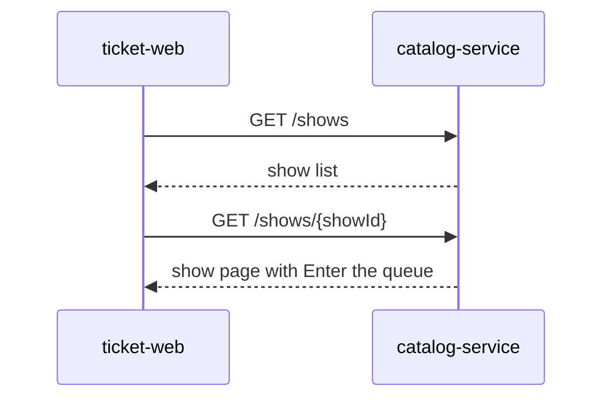
<br/>

1. **List shows.** ticket-web calls `GET /shows`. catalog-service returns a page of shows. CDN can answer this. Failure if skipped: there is no place to pick a show.
2. **Open one show.** User clicks a row. `GET /shows/{showId}` returns details and a cached `remainingHint`. That hint is catalog's last poll of inventory `GET /availability`, not a live `DECR`. The page has **Enter the queue**. Failure if skipped: join has no `showId`.
3. **Do not join yet.** This path does not touch waiting-room Redis, and it does not hit inventory for every browser. Failure if skipped into the room on list load, or if remaining is a live inventory read: every catalogue browse becomes a waiter or an inventory stampede.

### Enter

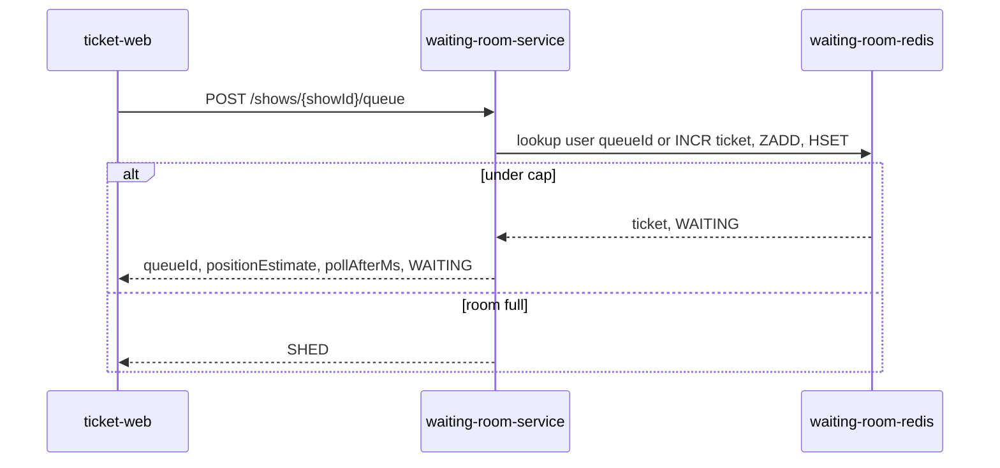
<br/>

1. **Enter the queue.** On the show page the user taps **Enter the queue**. That is `POST /shows/{showId}/queue`. `userId` comes from auth. Failure if skipped: clients go straight at `POST /shows/{showId}/hold`.
2. **Bind the wait.** `waiting-room-service` binds the queue to `userId` + `showId`. If `show:{showId}:user:{userId}` already has a `queueId`, reuse it. Otherwise Redis `INCR` mints the ticket, `ZADD` places the waiter, `HSET` stores state and TTL. Client sees `queueId`, a position estimate, and `pollAfterMs`.
3. **Shed if full.** Beyond the hard cap, return `SHED` / "sale busy, try again." Failure if skipped: the room becomes an unbounded Redis outage.
4. **Keep the same place.** A refresh hits the same `userId` key, not a new ticket. Failure if skipped: power users and bots jump the line.

### Poll

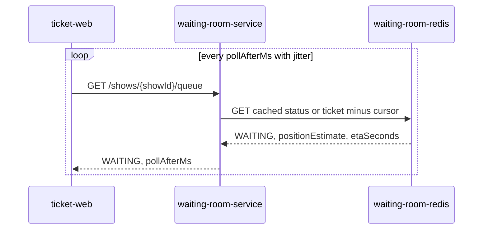
<br/>

1. **Honor `pollAfterMs`.** ticket-web waits, then adds jitter. Far from the head: about 10s. Near the head: about 2s. Failure if skipped: 500k waiters × 1 poll / 3s ≈ 167k RPS of status reads, still cheaper than booking if the path stays Redis-local.
2. **Cheap read.** Status hits the short-TTL cache or `ticket - promotedCursor`. The same call refreshes `expiry` on `show:{showId}:q:{queueId}` and the user binding. No inventory `DECR`, no payment, no heavy auth. Failure if skipped: every heartbeat becomes a book attempt, or an idle tab is never detected.
3. **Honest UI.** Show "you are roughly #N." Do not say seats are held. **Hold** stays disabled while `state` is `WAITING`. Failure if skipped: users treat a queue number as a reservation.

### Admit

How the browser learns it may enable **Hold**. No push. The next poll is the signal.

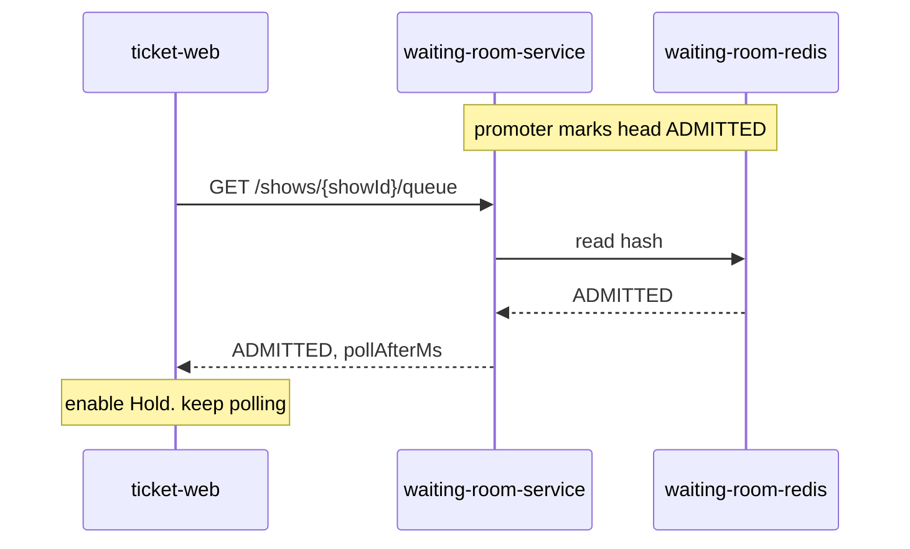
<br/>

1. **Promote from a free slot.** While `show:{showId}:admitted` is under the token pool, the promoter pops the head, sets `ADMITTED`, `INCR` admitted, and `INCR` `promoted`. That write happens on the room, not on a websocket to the browser. Failure if skipped: admit rate tracks wall-clock open and booking melts, or a finished booker holds a slot forever.
2. **Next poll is the signal.** ticket-web is already looping `GET /shows/{showId}/queue`. When the hash is `ADMITTED`, that GET returns `state: ADMITTED` and a shorter `pollAfterMs` (about 2s). There is no push channel. Failure if skipped: the user sits on "you are #N" after they already have a slot.
3. **Enable Hold.** ticket-web turns **Hold** on. **Pay** stays off until a hold succeeds. Copy is "you can book now," not "seats are held." Keep polling: those heartbeats refresh the booking-window TTL. Failure if skipped: they never see Hold, or they enable it, go silent, and Expire admitted takes the slot.
4. **Hold is still gated.** The button is a hint. `POST /shows/{showId}/hold` still goes to booking, which asks `GET /shows/{showId}/admission`. See Hold. Failure if skipped: a forged click writes inventory without the room.

### Expire waiting

Idle in line. Never admitted. Token pool does not move. **room-sweeper** is a loop inside `waiting-room-service`, not a new service.

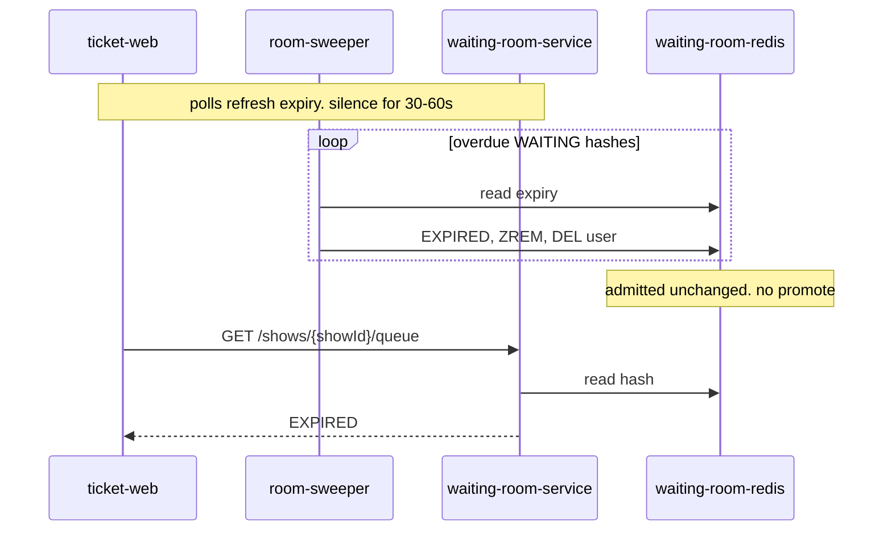
<br/>

1. **Heartbeat while WAITING.** Each `GET /shows/{showId}/queue` refreshes `expiry` on `show:{showId}:q:{queueId}`. TTL is a few missed polls (about 30-60s). Failure if skipped: a closed laptop stays in the zset until the sale ends.
2. **room-sweeper drops the waiter.** The loop finds overdue hashes still in `WAITING`. It sets `EXPIRED`, `ZREM`s `show:{showId}:wait:{shard}`, and deletes `show:{showId}:user:{userId}`. Redis key TTL alone does not `ZREM`. Failure if skipped: ghost members and a rotting ETA.
3. **Do not touch admitted.** This user was never in the token pool. No `DECR` on `show:{showId}:admitted`. The promoter does not run. Failure if skipped: a missed-poll waiter steals a booker slot, or the room promotes for no reason.
4. **Client learns they are gone.** The next poll hits the room API, not the sweeper, and returns `EXPIRED`. `GET /shows/{showId}/admission` is `isAllowed: false`. **Hold** stays disabled. Failure if skipped: the UI keeps showing a place in line that Redis already dropped.

### Expire admitted

Idle after admit. Never finished hold or pay. That is the slot that opens. Same **room-sweeper** loop as Expire waiting.

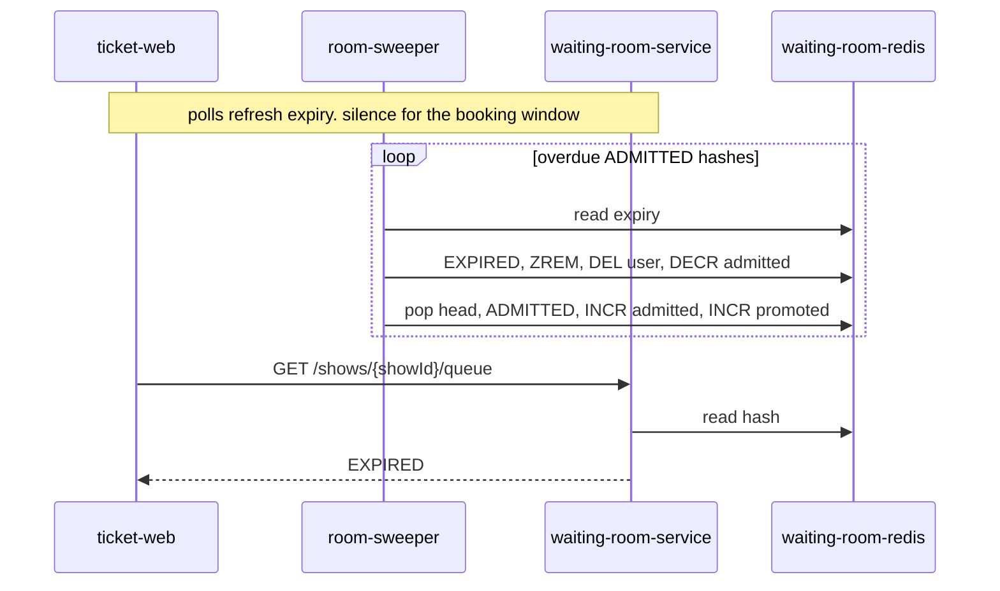
<br/>

1. **Heartbeat while ADMITTED.** Same poll refreshes `expiry`. TTL is the booking window (minutes), not 30-60s. Failure if skipped: an idle admittee holds a token-pool slot until the sale ends.
2. **room-sweeper frees the slot.** Overdue hash in `ADMITTED`: set `EXPIRED`, `ZREM` the shard, delete the user binding, then `DECR` `show:{showId}:admitted`. Redis deleting a key on TTL does not `DECR`. Do not use expire pub/sub at 500k waiters. Failure if skipped: `admitted` sticks at the cap and the line never moves.
3. **Promoter pulls the next head.** A free slot means `admitted` is under the pool. The same room process pops the next waiter, marks `ADMITTED`, `INCR` admitted, `INCR` `promoted`. Same ticker as Complete. Failure if skipped: the slot opens and nobody is invited.
4. **Hold expiry is a different sweeper.** If they already held, **booking-sweeper** should have called `DELETE /shows/{showId}/queue` already. See Expire hold. **room-sweeper** is the fallback when they never held, or booking is late. Inventory still expires the lease on `expiresAt` so seats return. Failure if skipped: an expired tab can still call hold, or a held seat never returns while the room already admitted the next person.

### Hold

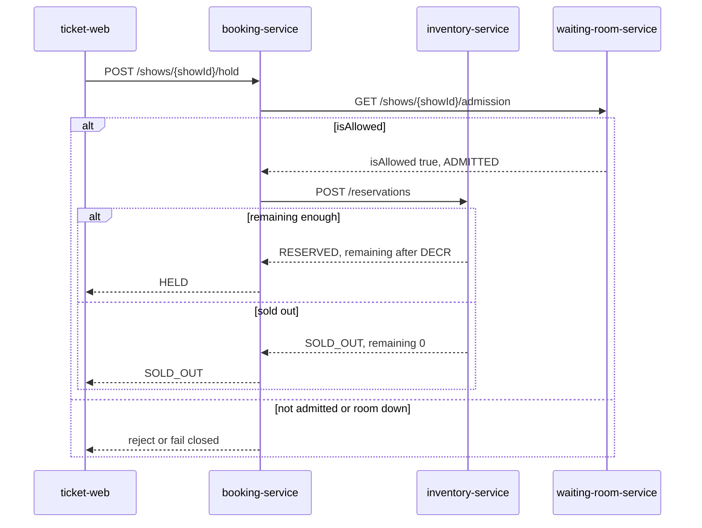
<br/>

1. **Client calls booking.** The user taps **Hold** because Admit enabled it. `POST /shows/{showId}/hold` goes to `booking-service`. Failure if skipped: nothing. Booking is the admission gate.
2. **Booking asks the room.** `booking-service` calls `GET /shows/{showId}/admission`. `isAllowed` is true only when state is `ADMITTED`. Failure if skipped: anyone who can hit hold writes inventory.
3. **Fall closed.** If `waiting-room-service` is down, `booking-service` refuses checkout. Failure if skipped: oversold inventory and a melted cluster.
4. **Reserve is not the room.** After `isAllowed`, booking-service calls `POST /reservations`. Inventory atomic `DECR`s `inv:{showId}:{ticketTypeId}:remaining`. That is how remaining is told: the hold result, not a queue poll. One live hold per `userId` per `showId`. A second POST while `HELD` reuses it. Client gets `holdId`, `expiresAt`, `state: HELD`, and turns **Pay** on. Failure if skipped: admitted users stampede hold as an unbounded writer set, or two leases lock the same user.
5. **Sold out is allowed after admit.** Remaining can hit zero while people are still `ADMITTED`. Inventory returns `SOLD_OUT`. **Hold** stays on only while the room is `ADMITTED`; Pay stays off. The room does not `DECR` remaining. Failure if skipped: an empty inventory still looks bookable, or the room is blamed for sold out.
6. **Honor `expiresAt`.** That clock is booking's, not the room's. **booking-sweeper** fires it and `INCR`s remaining. See Expire hold. Failure if skipped: Pay stays on after seats are already back in the pool.

### Expire hold

Idle after a successful hold. Did not pay before `expiresAt`. The room does not watch inventory. **booking-sweeper** is a loop inside `booking-service`, not a new service.

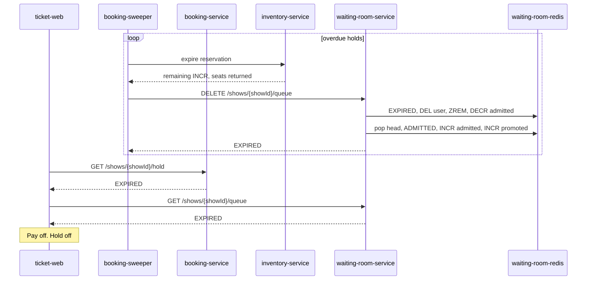
<br/>

1. **The room does not see the lease.** Inventory TTL and Redis key expiry never reach waiting-room Redis. **room-sweeper** only reads waiting-room hashes. Failure if skipped: people assume Redis expire on a reservation `DECR`s `admitted`. It does not.
2. **booking-sweeper owns `expiresAt`.** The loop marks the hold `EXPIRED`, `INCR`s `inv:{showId}:{ticketTypeId}:remaining`, then calls `DELETE /shows/{showId}/queue` with `{ "reason": "hold_expired" }`. Same call as Complete, different hash state. Failure if skipped: seats are free and the token-pool slot stays occupied until **room-sweeper** hits Expire admitted.
3. **Room API releases the path.** Lookup `show:{showId}:user:{userId}`, set `EXPIRED`, delete the user binding, `ZREM` the shard, `DECR` `admitted`, promote the next head. `GET /shows/{showId}/admission` is `isAllowed: false`. One shot. No retry **Hold**. Failure if skipped: the next waiter never moves.
4. **Client learns on the next poll.** `GET /shows/{showId}/hold` hits the booking API, not the sweeper, and is `EXPIRED`. `GET /shows/{showId}/queue` is `EXPIRED`. **Pay** and **Hold** go off. Copy is "hold expired, seats released." `POST /shows/{showId}/payment` against that `holdId` is rejected. **room-sweeper** is only the fallback if booking-sweeper never called. Failure if skipped: they tap Pay against a dead lease, or the UI still shows they can book.

### Pay

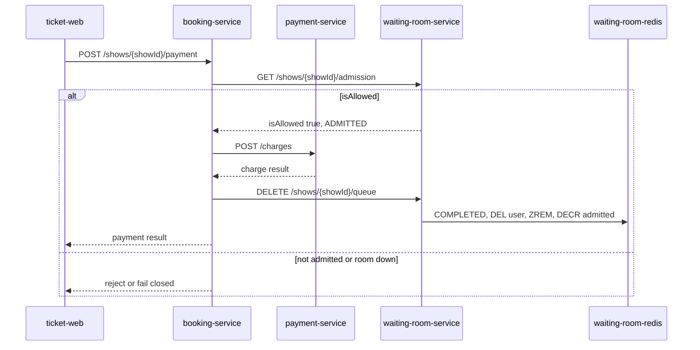
<br/>

1. **Client calls booking.** `POST /shows/{showId}/payment` goes to `booking-service`. Failure if skipped: nothing. Booking is the admission gate.
2. **Booking asks the room again.** Same `GET /shows/{showId}/admission`. `isAllowed` is true only when state is `ADMITTED`. Failure if skipped: anyone who can hit pay charges a card without the room.
3. **Fall closed.** If `waiting-room-service` is down, `booking-service` refuses payment. Failure if skipped: money moves while the room cannot confirm the user.
4. **Capture is not the room.** After `isAllowed`, booking-service checks the hold is still `HELD`, then calls `POST /charges` on `payment-service`. Card rails are a later plane. An expired hold is rejected here. See Expire hold. Failure if skipped: admitted users skip pay, booking charges without the room, or a charge hits seats inventory already returned.

### Complete

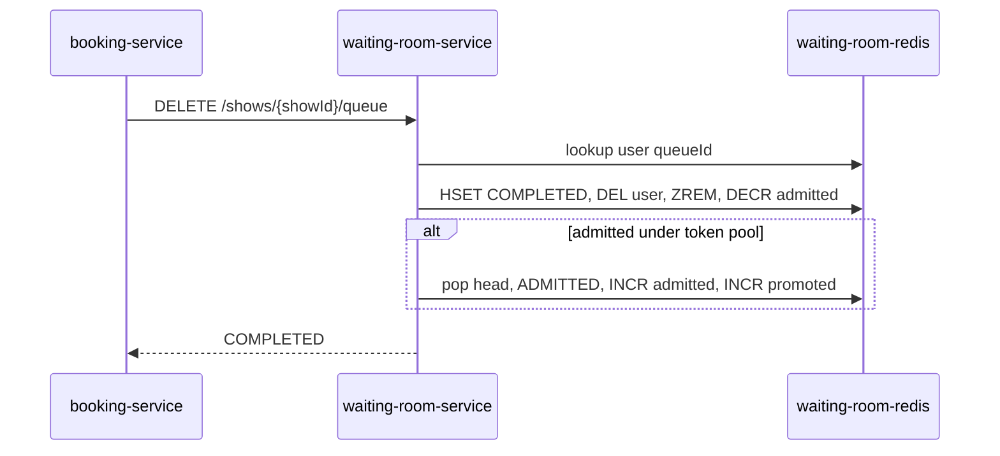
<br/>

1. **Booking tells the room.** After a successful charge, `booking-service` calls `DELETE /shows/{showId}/queue`. It does not write Redis. Failure if skipped: a paid user stays `ADMITTED` until TTL and holds a token-pool slot.
2. **Drop this waiter.** Room looks up `show:{showId}:user:{userId}`, sets the hash to `COMPLETED`, deletes the user binding, `ZREM`s the shard, and `DECR`s `admitted`. The arrival `ticket` counter does not move. `promoted` does not rewind. Failure if skipped: the same `userId` can book again on the old `queueId`.
3. **Move the next head.** A free slot means `admitted` is under the pool. The promoter pops the next waiter, marks `ADMITTED`, `INCR`s admitted, and `INCR`s `promoted` (the ticker the UI uses for ETA). Failure if skipped: the line does not advance after a successful book.
4. **Sweepers are the fallback.** A dead hold should hit this same `DELETE` from **booking-sweeper**. If they never held, **room-sweeper** `DECR`s admitted. Failure if skipped: abandoned bookers freeze the token pool.

## Failure points

If booking can hold without the room, or the room is uncapped, you moved the stampede. You did not absorb it. Load (poll RPS, memory, shards) belongs in these tables. Everything else freezes the line, desyncs seats, or cheats FIFO. Fail closed on booking is a product stop, not a silent melt.

### Kill the sale

| Failure | Blast | How we handle | What remains |
| --- | --- | --- | --- |
| booking skips `GET /admission` | Every admitted or forged client writes inventory. Auth, booking, inventory, and payments melt in the open second | `booking-service` is the gate. Hold and pay always ask the room. Fail closed if the room does not answer | A bug or a second book path that bypasses booking still kills the sale |
| `waiting-room-service` or Redis down | No enter, no poll, no admit. If booking stayed open, hold would still stampede | Checkout fails closed. A closed sale with an apology beats an oversold cluster | No replica or Redis failover is specified. A blip closes the whole sale |
| Uncapped waiting room | 2M waiters move the outage from Postgres to Redis and the polling fleet | Hard cap (example 500,000) plus `SHED`, sized from memory and poll RPS before the event | `SHED` is a product failure. The sale looks busy, not broken |
| Clients ignore `pollAfterMs` | 500k waiters at 1 poll / 3s is about 167k RPS of status reads. Faster polling multiplies that | Server dictates `pollAfterMs`. Far from the head about 10s, near the head about 2s. Status is Redis-local or short-TTL cached. No booking DB on the poll path | A rogue client or bot farm can still hammer `GET /queue` |
| Catalogue origin on list load | 2M people opening `GET /shows` become origin writes if that path also joins the room | CDN on `catalog-service`. List and show pages are not waiting-room writes. Join is only `POST /queue` | Cold cache at T-0 still hits catalog origin |
| Live remaining on every poll or show load | 2M `GET /queue` or show-page hits become inventory reads. Inventory melts in the open second | Remaining lives on inventory. Catalog may CDN-cache `remainingHint` from a slow `GET /availability`. `GET /queue` never carries remaining. Live remaining is the `POST /reservations` `DECR` | A stale `remainingHint` can still show tickets after they are gone. An `ADMITTED` user can still get `SOLD_OUT` |
| One giant waiter list | 2M members, expensive `ZRANK`, Event A contends with Event B | Shard by `hash(userId) % N` or section. Keys per `showId`. Position is `ticket - promotedCursor` | A hot shard still concentrates load |
| Admit tied to wall-clock open | Booking and inventory cannot absorb 2M writers at T-0 | Sale start enables queue only. Admit rate follows the downstream token pool | A promoter that opens on the clock still dumps the token pool |

### Freeze the line

| Failure | Blast | How we handle | What remains |
| --- | --- | --- | --- |
| **room-sweeper** stopped | `WAITING` ghosts rot the zset. `ADMITTED` never `DECR`s. The token pool sticks at the cap. The line does not move | Polls refresh expiry. **room-sweeper** `ZREM`s `WAITING` (no `DECR`) and `DECR`s `ADMITTED` then promotes. Redis key TTL alone does not `ZREM` or `DECR` | If the loop dies, Expire admitted never runs. **booking-sweeper** can still free a slot after a hold dies |
| **booking-sweeper** stopped | Dead holds do not `DELETE /queue`. Seats may return on inventory, but `admitted` stays occupied until **room-sweeper** | **booking-sweeper** owns `expiresAt`, returns seats, then `DELETE /queue` with `reason: hold_expired`. **room-sweeper** is the fallback | Both sweepers dead: seats locked and slots stuck until a human notices |
| Pay succeeds, `DELETE /queue` never called | A paid user stays `ADMITTED` until TTL and holds a booker slot | After charge, booking `DELETE /queue`. Room sets `COMPLETED`, `DEL` user, `ZREM`, `DECR` admitted, then promotes | A crash between capture and `DELETE` relies on **room-sweeper**. Double-book on the old `queueId` is possible until then |
| Promoter does not run after a free slot | `admitted` drops under the pool and nobody is invited. **Hold** stays disabled for the head of the line | Complete, Expire admitted, and Expire hold all pop the next head, `INCR` admitted, `INCR` `promoted` | A promoter bug with a live sweeper still leaves empty booker slots |

### Desync seats

| Failure | Blast | How we handle | What remains |
| --- | --- | --- | --- |
| Hold lease outlives remaining `ADMITTED` window | **room-sweeper** expires the wait first. Pay fails closed (`isAllowed: false`). Seats stay locked until inventory `expiresAt` | Size the hold lease inside the remaining `ADMITTED` window. Keep polling so the room clock does not die first | A slow pay form plus a short remaining window still desyncs seats from the room |
| Inventory sweeper returns seats, room not told | Seats are free. The admit slot stays occupied. Next waiter is not promoted until a sweeper calls the room | The room does not watch inventory. **booking-sweeper** must `DELETE /queue`. Redis expire on a reservation does not `DECR` admitted | Any path that expires inventory without calling the room leaks a slot |

### Fairness

| Failure | Blast | How we handle | What remains |
| --- | --- | --- | --- |
| Refresh mints a new `queueId` | Power users and bots jump the line. FIFO is decoration | `waiting-room-service` keys the wait by `userId` per `showId`. `POST /queue` reuses the binding | Weak identity still lets multi-accounting mint many waits |
| Sticky session or cookie lost | A new cookie looks like a better ticket, or the real waiter cannot poll and expires | Bind wait to `userId` in the room. Admission uses `userId`, not a client cookie | Pre-auth must exist. Anonymous FIFO is the weak identity fallback (lottery) |
| Scripts grab queue ids early | The room fills with farms. Humans `SHED`. FIFO rewards the first bot | Authenticated FIFO with abuse demotion. Lottery when identity is weak. Hard cap plus `SHED` | The room does not prove bot fairness. That is a later plane |
| UI treats position as a seat | Users believe #42,131 is reserved inventory. Support load, chargebacks, not an infra melt | Estimate language. **Hold** disabled until `ADMITTED`. No seat reserved copy. Position is `ticket - promotedCursor` | Honest copy does not stop a screenshot of a queue number from going viral |

### Three clocks

| Clock | Owner | If the loop dies |
| --- | --- | --- |
| `WAITING` (30-60s) | **room-sweeper** | Ghost zset members, rotting ETA |
| `ADMITTED` (minutes) | **room-sweeper** | Token pool stuck at the cap |
| Hold `expiresAt` | **booking-sweeper** | Seats may be free, slot occupied until **room-sweeper** |

Fail closed is a product failure. Room down means checkout refuses. Size replicas before the event, not during it.

**Parent insight:** [Virtual Waiting Room: Absorbing the Open-Second Stampede](/insights/virtual-waiting-room-system-design)
