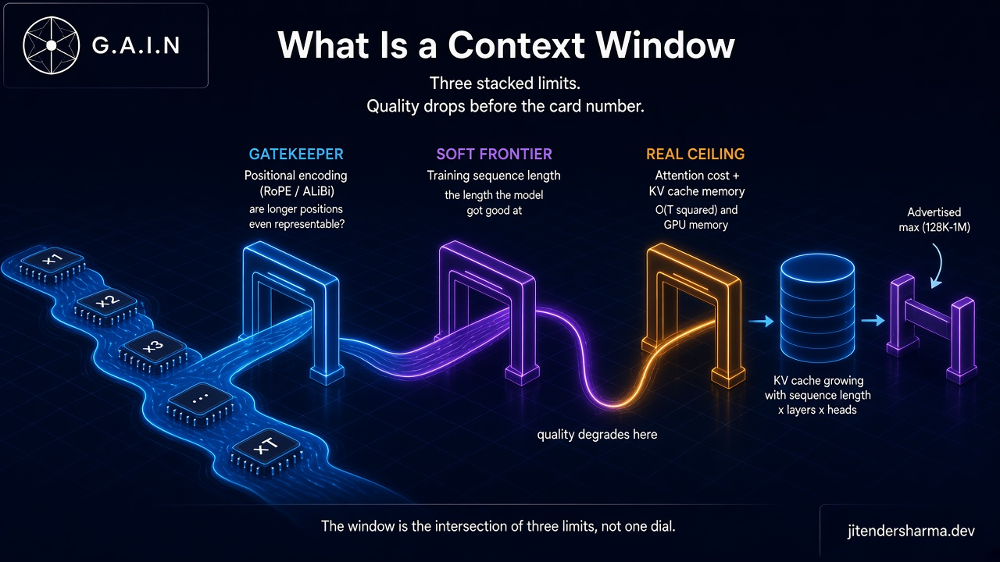
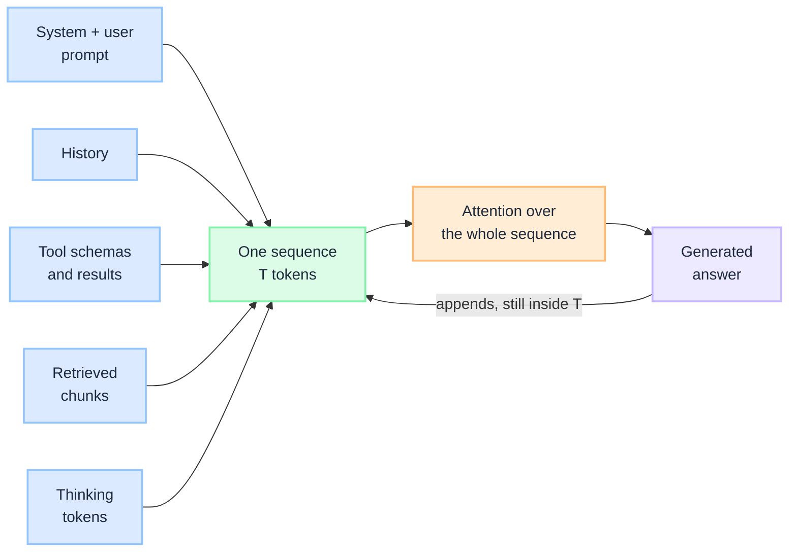
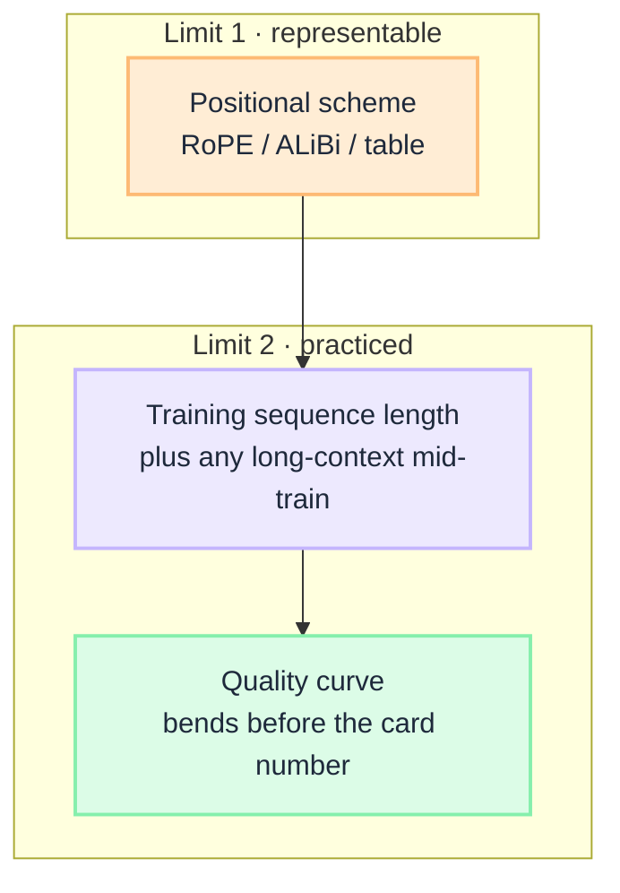
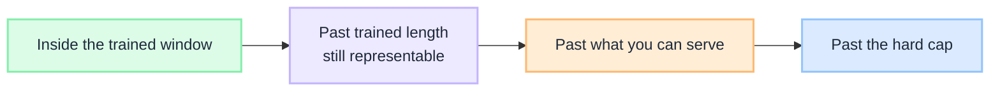

import Details from '@theme/Details';

 

# What Is a Context Window: How It Is Determined, and When It Degrades

The model card says 128K, or 1M, or 10M. Teams treat that number as working memory: stuff the prompt, the history, the tool schemas, and a pile of retrieved chunks, then expect the model to *use* all of it. Demos survive. Production does not. The failure is rarely that the API rejected the request. It is that quality bent much earlier than the advertised max, and nobody had named the three limits that actually set the window.

A **context window** is the maximum number of tokens the model can attend to in a single forward pass. Prompt, conversation, tool results, retrieved evidence, internal "thinking", and the answer itself all share that one budget. Nothing outside it exists, whatever the label on the model says.

This is a **concept primer**. It unpacks the short section in [Before Training an LLM](/insights/before-training-an-llm): the window is not a hyperparameter you turn. It is the intersection of three stacked limits.

:::tip[THE CLAIM]
**The advertised context window is a cap, not a quality guarantee.** Positional encoding decides whether a longer position is even representable. Training sequence length decides the length the model actually got *good* at. Attention cost and KV-cache memory decide what you can serve. Quality usually drops at the length the model was trained on, not at the advertised max.
:::

<!-- truncate -->

## The bottom line first

- **The context window is tokens in one forward pass**, not characters, not "pages", and not a private scratchpad beside the model.
- **It is three stacked limits, not one dial.** Representable positions, trained length, and serving memory. The usable window is whatever is smallest after all three.
- **Positional encoding is the gatekeeper.** A learned table stops when it runs out of rows. RoPE and ALiBi still give every extra token a position, so the model can *run* on longer input. Being able to run is not the same as being accurate.
- **Training length is the soft frontier.** Past the lengths the model saw while learning, attention still runs, and quality falls. Extension tricks (PI, NTK, YaRN) stretch the map. They do not replay the training.
- **KV-cache memory is the real ceiling in production.** Standard attention is quadratic in sequence length. Cache size grows with `length × layers × heads`. For long contexts the cache can outgrow the weights.
- **Budget against the frontier you will feel.** Pack RAG and history to the length the model was trained (or extended) to use well, not to the API max. The answer and any thinking tokens spend the same window.

## What a context window actually is

Every inference call is one sequence: tokens in, next-token probabilities out. The model does not hold a second memory. If a fact is not in the weights and not in this sequence, it is not available for this call. That sequence *is* the context window.

| Occupies the window | Does not occupy the window |
| --- | --- |
| System prompt and developer instructions | Frozen weights (the model's parameters) |
| Conversation history | Databases, indexes, and files on disk |
| Tool schemas and tool results | Anything retrieved but never inserted |
| RAG chunks packed into the prompt | Tokens already dropped by truncation |
| Hidden "thinking" tokens on reasoning models | The next request (a new window) |
| The answer being generated | |

The window is counted in **tokens**, not words or pages. 128K tokens of code is a different amount of text than 128K tokens of English. The budget is 128K tokens either way.

 

Prefill reads the prompt in one parallel pass. Decode writes the answer one token at a time, each new token attending over everything already in the sequence. That loop is the subject of [After Training an LLM](/insights/after-training-an-llm). The window is the length of the sequence that loop is allowed to see.

The parent lifecycle is [How LLM Works Under the Hood](/insights/how-llm-works-under-the-hood). Shape and vocabulary are fixed before training. The window is the one "size" that is *not* a tensor shape. It emerges from the three limits below.

## Limit 1: positional encoding (the gatekeeper)

Self-attention is permutation-invariant. Without a position signal, `dog bites man` and `man bites dog` are the same bag of vectors. **Positional encoding** is how the model knows order. It also decides whether a position past some N is even *representable*.

| Scheme | How position is injected | What happens past the trained length |
| --- | --- | --- |
| **Learned absolute embeddings** | A table of size `(max_positions, D)`. Position 4097 has a row only if you allocated it. | **Hard cap.** There is no vector for that index. GPT-2-style models stop here. |
| **RoPE (rotary)** | Rotate query and key vectors by an angle that depends on position. Relative distance shows up in the inner product. No row-per-position table. | **Representable, not necessarily good.** Angles leave the range the model practiced. Modern default (Llama, GPT-class, Gemini-class, Claude-class). |
| **ALiBi** | Add a distance penalty directly onto attention scores. No extra position parameters. | **Extrapolates more cleanly** than early RoPE, still not a quality guarantee. |

RoPE is the gatekeeper you will meet in production. It does not store "position 128000". It stores a recipe for rotating a vector at that index. That is why vendors can advertise windows far past original training length without resizing a table. The recipe still has a design range: the RoPE base frequencies were chosen so that the wavelengths cover the distances seen in training. Past that, the geometry is an extrapolation.

Three inference-time stretches are common. None of them is a new architectural dial:

| Technique | What it actually does |
| --- | --- |
| **Position interpolation (PI)** | Compresses inference positions back into the trained range. 128K indices are squeezed into the original 4K (or 8K) span. Relative distances shrink. |
| **NTK-aware scaling** | Changes the RoPE base so local (high-frequency) structure stays put and long-range (low-frequency) structure stretches. |
| **YaRN** | Combines interpolation with an attention-temperature adjustment so the softmax does not collapse on the stretched distances. |

These methods make longer positions *legal* for RoPE. They do not replay pre-training at the new length. Short continued training at the target length (a "long-context mid-train") is what actually moves the soft frontier in Limit 2. If you only stretch RoPE at serve time, you have changed the map, not the territory.

:::tip[TAKEAWAY]
**Ask "can this position be encoded?" before you ask "is the model good at this length?"** Absolute embeddings answer with a table size. RoPE and ALiBi answer with a recipe you can stretch. Stretching is Limit 1. Quality is Limit 2.
:::

## Limit 2: training sequence length (the soft frontier)

Representable is not the same as *practiced*. During training, each sequence has a length T. Attention learns which distances matter by seeing those distances, over and over, while the loss falls. Induction heads, retrieval heads, and long-range coreference are skills acquired at the lengths that were actually batched.

That length is a **soft frontier**:

- Inside it, quality is what the training run bought.
- Around it, quality starts to bend: the model still emits tokens, but it uses the far past less reliably.
- Past it, you are asking attention to score distances it was never rewarded for getting right.

Frontier cards that say 128K or 1M are usually a combination of (a) a positional scheme that can represent that length, (b) some continued training at long sequences, and (c) a serving stack that will accept the request. They are not a promise that needle-finding, multi-hop reasoning, and instruction-following are flat from token 1 to token N.

Two facts surprise teams who treat the card as a quality SLA.

**The curve is not a cliff at N.** Perplexity and task accuracy often sag *before* the trained max. Recency bias is real: the end of the prompt is over-weighted. The start is sometimes over-weighted too (it sat in the residual stream the longest). The middle is where evidence goes to die. That U-shape is the "lost in the middle" failure: the fact was in the window, the model did not use it. Packing order is an architecture decision, not a prompting flourish. See [RAG Is Not a Database](/insights/rag-is-not-a-database) on rank-and-pack.

**Extension is cheaper than training, and it shows.** PI / NTK / YaRN plus a short long-context fine-tune can move the API max by an order of magnitude. Multi-hop reasoning over a 200-page pack still tracks how much *long* data the model saw, and whether those sequences were the same shape as your production pack (docs, code, tool traces) or a different distribution.

 

:::tip[TAKEAWAY]
**Budget prompts against the length the model was trained (or mid-trained) to use well.** The API will often accept more. Acceptance is Limit 1 plus Limit 3. Usefulness is Limit 2.
:::

## Limit 3: attention cost and KV-cache memory (the real ceiling)

Even if positions encode and the model was trained at that length, you still have to *run* attention over T tokens, on a GPU, for concurrent users.

**Compute.** Standard self-attention compares every token to every other allowed token. Cost is **O(T²)** in sequence length per layer. Prefill (the prompt) is compute-bound: a large matmul over all T positions at once. Decode is sequential: each new token attends over the whole cache. [After Training an LLM](/insights/after-training-an-llm) is the working map of that loop.

**Memory.** In each layer, every token produces a key vector and a value vector. Those vectors do not change once computed, so they are stored in the **KV cache**. Cache size grows with sequence length, depth, and the number of KV heads. For long contexts the cache can exceed the memory used by the model weights themselves. That is the serving ceiling: not "the model cannot see this", but "this request does not fit next to the other users on the box."

Bytes for one request, ignoring fragmentation:

`2 (K and V) × layers × kv_heads × head_dim × seq_len × bytes_per_element`

Llama-3-class 8B-ish shape: 32 layers, 8 KV heads, head dim 128, FP16 (2 bytes):

`2 × 32 × 8 × 128 × 2 = 131,072 bytes per token` (128 KB per token)

| Sequence length | KV cache for one request |
| --- | --- |
| 4,096 | ~0.5 GB |
| 32,768 | ~4 GB |
| 128,000 | ~16 GB |

The 8B *weights* in FP16 are about 16 GB. At 128K, **one request's KV matches the entire model**. Concurrent 128K chats are a memory problem before they are a quality problem. Grouped-query attention (fewer KV heads than query heads) is why this is 128 KB/token rather than ~512 KB/token for full multi-head attention. Quantising the cache, paging it (vLLM), or using sliding-window / sparse attention are how serving stacks push the ceiling. None of those change what the weights know.

Paged attention, continuous batching, and KV quantisation are execution tricks. They pack more users onto the same hardware. They do not enlarge Limit 2. If quality has already bent, cheaper KV will not un-bend it.

:::tip[TAKEAWAY]
**The number you can serve is often smaller than the number the model can encode.** Architects feel Limit 3 as latency, GPU memory, and cost per request. They should not confuse a bigger GPU with a better long-context model.
:::

## When quality starts degrading

Degradation is not one event. It is three failure signatures, and they show up in a predictable order.

 

### 1. Inside the trained window: the model sees it and does not use it

This is the earliest, and the one RAG systems hit first.

- **Lost in the middle.** The model pays more attention to the start and the end of the prompt. A fact in the middle can sit in the window and still be ignored.
- **Needle tests vs real work.** Finding one planted sentence at 128K is not the same as summarising a conflicting 80-page pack. A marketing score of "100% at 128K" means the model can spot a fact. It does not mean it can do your task at that length.
- **Packing without a budget.** Ten retrieved chunks that "fit" can still drown the instruction. Rank, dedupe, and cap. [RAG Is Not a Database](/insights/rag-is-not-a-database) is the pack discipline. [Retrieval Is a Governed Action](/insights/retrieval-is-a-governed-action) is the policy discipline: a chunk must be *allowed* in before it is allowed to spend the window.

Quality has already started degrading here, at lengths the card still calls "well within context."

### 2. Past trained length: attention still runs, answers get worse

RoPE still produces a vector. The forward pass still returns tokens. What you observe:

- Instructions at the top are forgotten by the time generation starts.
- References to early entities ("the first policy", "step 2 above") collapse.
- Code edits miss files that were in the prompt but far from the cursor.
- The model repeats, hedges, or invents rather than look 40K tokens back.

This is Limit 2 asserting itself. Stretching RoPE (PI, NTK, YaRN) without a long-context mid-train moves you into this band on purpose. A mid-train moves the band. It does not make the curve perfectly flat.

### 3. Serving cliff: memory and latency fail before the tokenizer does

Prefill time grows with prompt length. Decode stays memory-bound on a cache that now spans hundreds of thousands of tokens. Symptoms:

- Time-to-first-token blows the SLO on "just paste the spec".
- A single fat request evicts other users (or the replica OOMs).
- Cost per call is dominated by input tokens you packed "because we had room."

This is Limit 3. Bigger cards do not fix a prompt that should have been a retrieval pack with a token budget.

### 4. Hard stop: unrepresentable, or the API max

Learned absolute positions refuse the index. Provider APIs reject the request. Truncation drops the head or the tail, usually the wrong one. This is the failure everyone monitors, and the one that arrives last.

### Reasoning traces spend the same window

A reasoning model does not own a second tape. Intermediate "thinking" is generated tokens. They occupy the context window, run through the same decode loop, and are billed as output. A 4,700-token chain plus a 200-token answer has spent 4,900 tokens of Limit 2 and Limit 3 before the user reads a line. If you also stuffed a 60K RAG pack, the thinking is competing with the evidence. The family label did not add memory. (A companion decision guide on reasoning vs general vs coding models is coming soon.)

| What you observe | Which limit is talking | What to do |
| --- | --- | --- |
| Fact was in the prompt, answer ignores it | Limit 2, inside the window | Re-rank, put evidence next to the question, cap the pack |
| Long doc "fits", instruction-following collapses | Limit 2, past practiced length | Shorten, chunk-and-map, or pick a model mid-trained for this length |
| First token takes seconds, GPU memory spikes | Limit 3 | Budget T, quantise or page KV, do not confuse this with quality |
| API 400 / truncation | Limit 1 or provider cap | Hard max. You were already past useful quality |
| Reasoning call is slow and expensive, short answer | Same window, thinking tokens | Set a thinking budget; do not also max out RAG |

## What spends the window, and what does not set it

**Does not set N**

| Dial | What it actually sets |
| --- | --- |
| `hidden_size`, `num_layers`, `num_heads`, FFN width | Parameter count and compute per token. See [Before Training an LLM](/insights/before-training-an-llm). |
| `vocab_size` | How much text fits in N tokens, not N itself. |
| Model family label (general / reasoning / coding) | Post-training objective and serving behaviour, not a larger window. |
| A bigger GPU | How much of Limit 3 you can buy. Not Limit 2. |

**Does spend N**

System prompt, few-shot exemplars, conversation history, tool schemas, tool results, retrieved chunks, thinking tokens, and the answer. Truncation is a policy: if you drop the head, you drop instructions; if you drop the tail, you drop the latest evidence. Neither is free. Treat the window as a budgeted surface, the same way you treat a payload limit on an API.

:::important[Decision first, context second]
A retrieved chunk that is not entitled to be seen must not enter the window. Fitting is not permission. That boundary is [Retrieval Is a Governed Action](/insights/retrieval-is-a-governed-action), not a tokenizer setting.
:::

## How it connects to related insights

| Related insight | Relationship |
| --- | --- |
| [Before Training an LLM](/insights/before-training-an-llm) | Parent: names the three factors in one section. This page is the full unpack. |
| [After Training an LLM](/insights/after-training-an-llm) | Prefill, decode, and why the KV cache is the growing cost at serve time. |
| [How LLM Works Under the Hood](/insights/how-llm-works-under-the-hood) | Lifecycle map. Context window sits in Stage 1 as a budgeted choice, Stage 4 as a serving constraint. |
| [RAG Is Not a Database](/insights/rag-is-not-a-database) | Rank-and-pack and token budgeting: how retrieval becomes a context pack that *fits and is used*. |
| [Retrieval Is a Governed Action](/insights/retrieval-is-a-governed-action) | Policy before packing: which chunks may spend the window at all. |

## Key takeaways

- **Treat the card number as a cap.** The usable window is the intersection of representable positions, trained length, and KV you can afford.
- **Degradation starts inside the advertised max.** Lost-in-the-middle and recency bias show up before any hard reject.
- **Budget against trained (or mid-trained) length**, not against the API max. Stretching RoPE is not a substitute for long-context training.
- **Watch the KV cache as a product constraint.** At long T it rivals the weights. Latency and memory will fail you before the tokenizer does.
- **Pack with intent.** Retrieval, history, and thinking tokens all spend the same working memory. Rank, cap, and govern what enters.

:::info[Builds on]
[Before Training an LLM](/insights/before-training-an-llm) · [After Training an LLM](/insights/after-training-an-llm) · [How LLM Works Under the Hood](/insights/how-llm-works-under-the-hood) · [RAG Is Not a Database](/insights/rag-is-not-a-database) · [Retrieval Is a Governed Action](/insights/retrieval-is-a-governed-action)
:::
