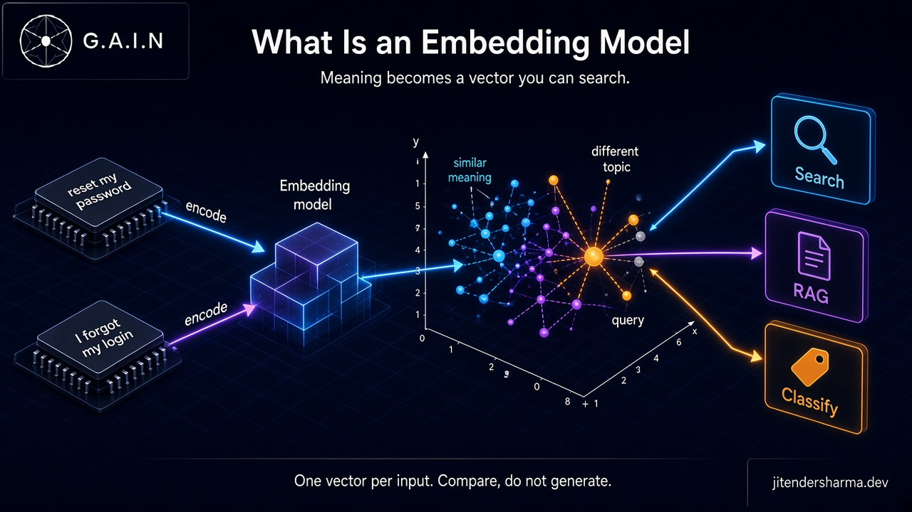
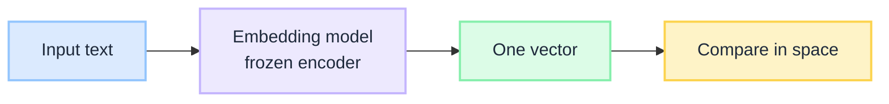
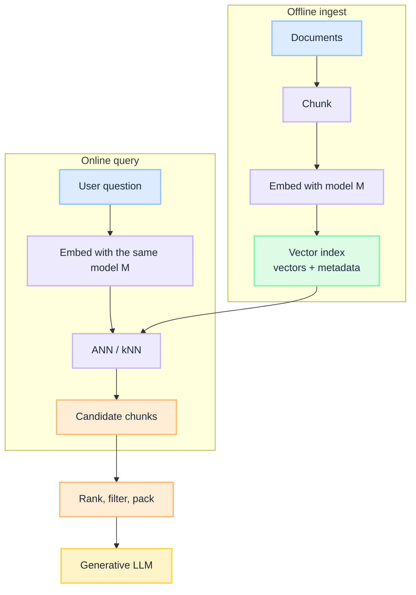

import Details from '@theme/Details';

<br/>


# What Is an Embedding Model: How Meaning Becomes a Vector You Can Search

"Reset my password" and "I forgot my login" share almost no tokens. A keyword index misses the paraphrase. An embedding model puts them near each other in a vector space, so a search can return the password-reset article. That is the whole job: turn meaning into coordinates you can **compare**. It does not write the reply.

An **embedding model** is a frozen encoder. You give it a chunk of text (or an image, or audio). It returns **one** dense vector. Nearby vectors were trained to mean "similar." Far vectors were trained to mean "not that." Retrieval, clustering, dedup, and cheap classification all sit on that geometry. Generation does not.

This is a **concept primer**. It unpacks the map that [RAG Is Not a Database](/insights/rag-is-not-a-database) then ranks, packs, and governs.

:::tip[THE CLAIM]
**An embedding model is a frozen encoder that maps an input to one vector so you can compare, not generate.** Close in that space means "trained as similar." It is the geometry under RAG, semantic search, clustering, and cheap classification. It is not the LLM's token table. Swap the model without re-embedding the corpus and the index is silently wrong.
:::

<!-- truncate -->

## The bottom line first

- **One vector per input.** Not a sequence of token vectors. Not a next-token distribution. A single point you can store and compare.
- **Compare, do not generate.** Search, RAG candidate fetch, clustering, dedup, recommendations, cheap labels. Use an LLM when you need writing or multi-step reasoning.
- **Where it runs:** twice. Offline ingest (chunk → embed → index) and online query (embed the question → nearest neighbours). It lives in the retrieval plane, before the generator.
- **The space is a training contract.** Cosine similarity is not a law of language. It is whatever the contrastive pairs taught.
- **The index is married to the model.** Dimension, pooling, and normalization are part of the key. Change any of them and every stored vector is in the wrong coordinate system.
- **Similarity is not permission.** Neighbours are candidates. [Retrieval Is a Governed Action](/insights/retrieval-is-a-governed-action) still has to decide who may see them.

## What an embedding model actually is

Three things get called "embeddings" in the same meeting. Only one of them is this page.

| Object | What it is | What you do with it |
| --- | --- | --- |
| **Token embedding table** | A lookup `(vocab_size, D)` inside a generative LLM. Each token id becomes a vector, then a *sequence* of vectors runs through the stack. | Generation. See [Before Training an LLM](/insights/before-training-an-llm). |
| **Embedding model** | A separate encoder. Input is a string (or image). Output is **one** vector, typically 384 to 3072 numbers, often L2-normalized. | Compare. Store. Search. Cluster. Classify. |
| **Chat / completion model** | A decoder that writes the next token. | Generate answers, plans, tool calls. |

The embedding model is usually an encoder-style reader: every token in the chunk can see every other token, then the sequence is **pooled** into one point. BERT-class models lived here first. Modern retrieval embedders (E5, GTE, Gecko, OpenAI `text-embedding-3`, Voyage, Cohere) are the same idea with contrastive training aimed at search. Some labs now distill a decoder into an embedding head. The serving contract does not change: **in goes text, out goes one vector.**

It is not a small LLM. It has no chat template you should be prompting for an answer. If you are sampling tokens, you picked the wrong model.


<br/>

## How it produces a vector

The forward pass is short.

1. **Tokenize** the input with that model's tokenizer. A different tokenizer is a different model.
2. **Encode** with a stack of transformer blocks. Bidirectional attention is the usual contract: the vector for "bank" can see "river" or "account" in the same chunk.
3. **Pool** the token states into one vector. Common recipes: the `[CLS]` state, mean of token states, or a learned pooling head.
4. **Normalize** (usually L2) so cosine similarity equals a dot product. Skip this and "long chunk" can look closer than "right chunk" because the vector is longer, not better.

You now have a point. You do not have an answer.

Here is the scheme as a 2-wide toy. Real models use hundreds or thousands of dimensions. The compare step is the same.

**Three inputs, already L2-normalized:**

| Text | Vector |
| --- | --- |
| `reset my password` | `[1.00, 0.00]` |
| `I forgot my login` | `[0.95, 0.31]` |
| `quarterly revenue fell` | `[0.00, 1.00]` |

**Cosine similarity** is the inner product of unit vectors (higher is closer):

| Pair | Cosine | Neighbour? |
| --- | --- | --- |
| password ↔ login | `1.00×0.95 + 0.00×0.31 = 0.95` | yes |
| password ↔ revenue | `1.00×0.00 + 0.00×1.00 = 0.00` | no |

Keyword overlap would have missed the first pair. The embedding model was trained so those paraphrases land nearby. The third sentence is orthogonal on purpose: different topic, different direction.

<Details summary="Cosine on unit vectors">

If `q` and `d` are L2-normalized, cosine is just a dot product:

```text
cos(q, d) = q · d = sum_i (q_i * d_i)
```

Range is `-1` to `1`. Retrieval almost always keeps the top positive neighbours. Inner-product indexes (IP) and cosine indexes agree only when every stored vector was normalized with the same recipe.

Unnormalized Euclidean distance is a different geometry. Do not mix metrics in one index.

</Details>

A **dual encoder** (this page) embeds the query and the document *separately*, then compares the two vectors. That is why you can pre-compute every document vector and search with ANN (HNSW, IVF, DiskANN). A **cross-encoder** reads query and document *together* and scores the pair. Better ranking, no pre-computed index of independent vectors. Production RAG usually embeds to fetch candidates, then optionally cross-encodes to re-rank. Do not ask the embedding model to do the re-ranker's job.

## How the space is learned

The coordinates are not discovered. They are trained.

The usual recipe is **contrastive**. Show a query and a passage that belong together (positive). Show passages that do not (negatives). Pull the positive pair together in vector space. Push the negatives away. InfoNCE / in-batch negatives is the workhorse. Hard negatives (near-miss passages) are what stop "any finance doc" from collapsing into one blob.

Consequences for architects:

- **Similar means "looked like a match in training."** Domain shift (legal, clinical, internal jargon, another language) is a new geometry, not a longer prompt.
- **Asymmetric search is a training choice.** Some models are trained query-to-passage (E5-style prefixes, instruction embedders). Embed the corpus as documents and the question as a query. Mix the prefixes and neighbours rotate.
- **You cannot interpolate a new model.** There is no row you can add. A new checkpoint is a new map. Re-embed everything.

[How LLM Works Under the Hood](/insights/how-llm-works-under-the-hood) is the generative lifecycle. An embedding model still has a train-then-freeze story. After freeze, inference is a forward pass to a vector, not a decode loop, and not a KV cache of next tokens.

## When to use it

Use an embedding model when the job is **place this text in a space and find its neighbours**.

| Job | Why embeddings fit | Watch-out |
| --- | --- | --- |
| **Semantic search** | Paraphrase and topic match without shared keywords | Exact SKUs, error codes, and names still want lexical / hybrid |
| **RAG candidate fetch** | First-stage retrieval into a vector index | Candidates are not evidence until ranked, filtered, packed |
| **Clustering / topic discovery** | Distance in space is a grouping signal | Cluster labels are yours to name; the model will not |
| **Dedup / near-duplicate** | Same meaning, different wording | Thresholds drift when the corpus mix changes |
| **Recommendations** | Item and user (or query) in one space | Popularity bias is in the pairs you trained on |
| **Cheap classification / routing** | Embed once, nearest label or a thin head | Closed taxonomy only. Escalates when unsure. A companion primer on embedding classifiers is coming soon. |

Use a generative LLM instead when you need:

- Open-ended writing, summaries, or tool-using agents.
- Multi-step reasoning ("given these three policies, who is entitled?").
- Labels that did not exist when you built the prototype store.

A common production split: embed to **find**, generate to **speak**. [What Is an Intent Router](/insights/what-is-intent-router) is the other cheap gate: some stacks embed the request to pick a route before any agent loop starts.

## Where it sits

Two clocks, one model.


<br/>

**Ingest** is a pipeline: parse, chunk, embed in batches, write vectors plus metadata (source id, ACL, timestamps). This is where most of the cost lives the first time, and again every time the model or the chunker changes.

**Query** is a latency path: embed one (or a few) strings, search the index, return ids. Tens of milliseconds is typical for the embed plus ANN hop if the model is local or pooled. Paying a generative API to "search" is the anti-pattern this model exists to avoid.

The embedding model does **not** sit inside decode. It does not occupy the KV cache. It does not see the tokens the chat model is about to write, unless you deliberately embed the conversation and search again (query rewrite, HyDE, follow-up retrieval). That second hop is still this model, still one vector, still candidates.

Same weights on both paths. If ingest used `model M, dim 768, cosine, mean-pool` and query uses anything else, you are comparing maps of different cities.

## How it is used in a RAG path

[RAG Is Not a Database](/insights/rag-is-not-a-database) is the pipeline. The embedding model is only the **find** geometry.

At query time a typical path is:

1. Scope by identity (ACL / tenant), not after the fact.
2. Embed the question with model `M`.
3. Hybrid retrieve: vector neighbours plus lexical hits, already filtered.
4. Re-rank (cross-encoder or LLM-as-judge, optional).
5. Pack a token budget. Deduplicate. Attribute sources.
6. Generate, or abstain.

Cosine top-k is step 3, not the product. Treating "the nearest five chunks" as the answer is how fluent wrong cites ship. [Hallucinations Is a System Design Problem](/insights/hallucinations-is-a-system-design-problem-not-model-problem) is what happens when that pack is thin and the generator is still allowed to talk.

[Retrieval Is a Governed Action](/insights/retrieval-is-a-governed-action) is the enforcement wrapping that find: who may retrieve, what metadata must come back, whether the tool is even on the manifest. An embedding model cannot do that. It will happily return a neighbour the caller is not entitled to, if you let the index see it.

## What it does not do

| Expectation | Reality |
| --- | --- |
| Understand like a chat model | No. It places a point. It does not read the neighbours back as prose. |
| Store the document | No. The index stores the vector and whatever metadata you attached. Lose the source blob and you have coordinates without a cite. |
| Grant access | No. Similarity is not an ACL. Filter first or you leak. |
| Survive a model swap | No. New checkpoint, new space. Re-embed the corpus. Version the index key with `model_id` + `dim` + `metric`. |
| Replace lexical search | No. Identifiers, errors, and exact titles still want BM25 (or equivalent) in a hybrid. |
| Set the context window of the LLM | No. Retrieval only decides which tokens you *offer*. The generator still has its own window. |
| Be the ranking SLA | No. Dual-encoder recall is the first stage. Cross-encoders and packing own precision. |

## When similarity lies

The forward pass stays green. Neighbours come back. They are just the wrong neighbours.

| Failure | What actually broke |
| --- | --- |
| **Model swap without re-index** | Query vectors live on map B. Corpus vectors still live on map A. Top-k is noise with good latency. |
| **Dimension / pooling / metric mismatch** | 768 vs 1024, CLS vs mean, cosine vs L2. Same symptom as a model swap. |
| **Unnormalized vectors** | Length masquerades as relevance. Long chunks dominate. |
| **Domain shift** | General-web geometry, specialist corpus. Paraphrases that matter in-house were never positives. |
| **Short or empty text** | A heading, a table cell, a "yes." Pooling has almost nothing to read. Neighbours become generic. |
| **Chunking that split the meaning** | The right sentence is in the previous chunk. The vector is faithful to a fragment. |
| **Multilingual / code-mix skew** | Training pairs were English-heavy. The other language collapses toward a centroid. |
| **Top-k looks fine in a demo** | Demo queries were in-distribution. Production queries were not. Eval on held-out paraphrases, not on the three happy-path questions. |

:::important[Green ANN is not a pass]
If you only alert on empty result sets, you will ship a retrieval path that always returns five chunks and routinely returns the wrong five. Score thresholds, hybrid overlap, and a golden paraphrase set catch this. The embedding call returning 200 does not.
:::

## How it connects to related insights

| Related insight | Relationship |
| --- | --- |
| [RAG Is Not a Database](/insights/rag-is-not-a-database) | Parent pipeline. This model is the find geometry, not the store and not the pack. |
| [Retrieval Is a Governed Action](/insights/retrieval-is-a-governed-action) | Neighbours are candidates. Policy still decides who may see them. |
| [How LLM Works Under the Hood](/insights/how-llm-works-under-the-hood) | Generative lifecycle. Embedding inference is a forward pass to a vector, not that decode loop. |
| [Before Training an LLM](/insights/before-training-an-llm) | The token embedding table `(V, D)` is a different object: a lookup inside generation. |
| [What Is an Intent Router](/insights/what-is-intent-router) | Another cheap gate at ingress. Some routers score with embeddings before any agent loop. |
| [Hallucinations Is a System Design Problem](/insights/hallucinations-is-a-system-design-problem-not-model-problem) | Wrong neighbours become fluent answers if the generator is still allowed to talk. |

Encoder-vs-decoder architecture, positional encoding, and embedding classifiers are companion explainers still in draft.

## Key takeaways

- **Pick this model when the job is compare.** One frozen vector per input. Search, RAG fetch, cluster, dedup, cheap labels. Not chat.
- **Keep ingest and query on the same map.** Model id, dimension, pooling, and metric are one key. Changing any of them means re-embedding the corpus.
- **Treat cosine as recall, not truth.** Dual-encoder neighbours are stage one. Rank, filter, pack, and abstain still sit downstream.
- **Do not confuse it with the LLM token table.** A generative model has a vocabulary lookup and a decode loop. An embedding model returns a point and stops.
- **Alert on wrong neighbours, not only on empty hits.** A 200 with five chunks is the silent failure.

:::info[Builds on]
[RAG Is Not a Database](/insights/rag-is-not-a-database) · [Retrieval Is a Governed Action](/insights/retrieval-is-a-governed-action) · [How LLM Works Under the Hood](/insights/how-llm-works-under-the-hood) · [Before Training an LLM](/insights/before-training-an-llm)
:::
