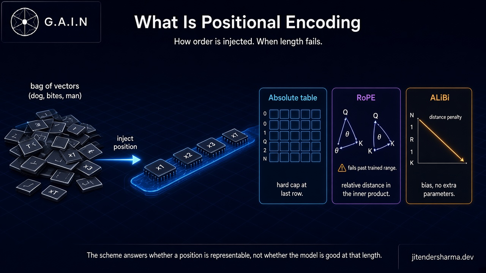
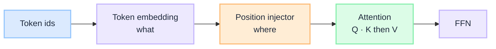

import Details from '@theme/Details';

<br/>


# What Is Positional Encoding: How Order Is Injected, and When It Fails

Self-attention does not know left from right. If you permute the tokens, the mix step still runs. `dog bites man` and `man bites dog` are the same bag of vectors until something injects **order**. That something is positional encoding. It is chosen with the other architectural dials, before a single training token is seen, and it is the gatekeeper of every long-context claim on a model card.

**Positional encoding** is the recipe that makes token index `t` different from token index `t+1` inside the network. It does not store facts. It does not enlarge working memory. It only answers one question: *is this position even representable?* Whether the model is *good* at that length is a different limit (training sequence length). Whether you can *serve* that length is a third (attention cost and KV-cache memory). A companion primer on those three stacked limits is coming soon.

This is a **concept primer**. It unpacks the positional dial named in [Before Training an LLM](/insights/before-training-an-llm).

:::tip[THE CLAIM]
**Positional encoding is a representability contract, not a quality SLA.** Learned absolute tables hard-cap at the last row. RoPE and ALiBi give a recipe you can stretch at inference. Stretching changes the map. It does not replay training. Quality fails when you leave the geometry the model practiced, often while the forward pass still looks healthy.
:::

<!-- truncate -->

## The bottom line first

- **Without positions, the sequence is a bag of vectors.** Attention is permutation-invariant. Order has to be injected.
- **Where you inject it matters.** Absolute embeddings are added at the bottom. RoPE rotates Q and K *inside* attention. ALiBi adds a distance penalty on the scores. Same job, three geometries.
- **The scheme is a day-zero dial.** You pick it with `hidden_size` and `num_layers`. Training fills values; it does not invent a new position recipe.
- **Absolute tables are a hard cap.** There is no vector for an index past `max_positions`. The API 400 is Limit 1, not a GPU problem.
- **RoPE is the production default.** Relative distance lives in the inner product. Longer indices are representable. They are not automatically in-distribution.
- **Failure starts as geometry, not as an error.** PI, NTK, and YaRN stretch RoPE so longer positions stay legal. They do not teach the model those distances. KV-cache OOM is a different failure.

## What positional encoding actually is

A token embedding says *what* the piece of text is. Positional encoding says *where* it sits in this sequence. Both are required before attention can mix usefully.

The original transformer added a position vector to each token embedding and then ran attention. Modern decoder-only LLMs usually keep the token embedding as meaning-only, and fold position into the attention scores themselves. That is why [During Training an LLM](/insights/during-training-an-llm) lists learned positional embeddings as *optional*: they exist only if the model is *not* using RoPE or ALiBi.


<br/>

Three families do that injection. They are not interchangeable at serve time.

| Family | Where order is injected | Extra parameters | Past the trained length |
| --- | --- | --- | --- |
| **Learned absolute** | Added to embeddings (bottom of the stack) | A table `(max_positions, D)` | **Hard stop.** No row, no vector. |
| **RoPE** | Rotation of Q and K inside every attention head | None for position itself (base frequencies are a hyperparameter) | **Representable.** Geometry leaves the practiced range. |
| **ALiBi** | Linear bias on attention scores by distance | None (per-head slopes are fixed) | **Representable.** Recency is baked into the bias. |

Sinusoidal encodings (the 2017 paper) sit historically between absolute tables and RoPE: a closed-form function of index, theoretically unbounded, mixed results as a production LLM default. You will meet them in textbooks. You will not meet them as the thing that sets a 128K card.

The rest of this page is the three families you actually choose between, how that choice is locked, and when each one starts to lie.

## Scheme 1: learned absolute positions (the hard table)

The simplest contract: allocate a vector per index.

- Shape: `(max_positions, D)`, same width as the token embedding.
- At index `t`, look up row `t` and add it to the token vector before the first block.
- Training learns those rows. Position 0 is a different point in space from position 4095.

Here is the whole scheme as a 3-wide toy. The vocabulary is `dog`, `bites`, `man`. The position table has **four** rows (`max_positions = 4`). Width is `D = 3` so the add is visible. Real models use `D` in the thousands and fill the rows with unstructured learned vectors. The arithmetic is the same.

**Token embeddings (what the word is):**

| Token | Vector |
| --- | --- |
| `dog` | `[4, 0, 0]` |
| `bites` | `[0, 4, 0]` |
| `man` | `[0, 0, 4]` |

**Position table (where it sits).** Rows 0-3 exist. Row 4 was never allocated.

| Index | Vector |
| --- | --- |
| 0 | `[1, 0, 0]` |
| 1 | `[0, 1, 0]` |
| 2 | `[0, 0, 1]` |
| 3 | `[0.5, 0.5, 0.5]` |
| 4 | no row |

**Same three words, two sentences.** Each input to the first block is token + row.

`dog bites man`:

| Token | + row | Input to block 1 |
| --- | --- | --- |
| `dog` | 0 | `[5, 0, 0]` |
| `bites` | 1 | `[0, 5, 0]` |
| `man` | 2 | `[0, 0, 5]` |

`man bites dog`:

| Token | + row | Input to block 1 |
| --- | --- | --- |
| `man` | 0 | `[1, 0, 4]` |
| `bites` | 1 | `[0, 5, 0]` |
| `dog` | 2 | `[4, 0, 1]` |

Without the table, both sentences are the same bag of three meaning vectors (`[4, 0, 0]`, `[0, 4, 0]`, `[0, 0, 4]`). Attention is permutation-invariant, so it cannot tell which animal did the biting. With the table, `dog` at the start is `[5, 0, 0]` and `dog` at the end is `[4, 0, 1]`. Different points. Order is now a first-class signal.

A fourth token still has a row (index 3). A fifth token needs index 4. That row does not exist. There is nothing to interpolate.

That table *is* the context-length cap for this scheme. Scale the toy up and you have GPT-2's 1024 and BERT's 512: if `max_positions` is 2048, position 2048 does not exist. Early BERT also put `[CLS]` at row 0. The API 400 is a missing embedding row, not a GPU problem.

Two consequences for architects:

1. **You cannot "turn up context" later** without resizing the table and training the new rows. That is a new model, not a serving flag.
2. **The failure mode is honest.** The runtime rejects the request or truncates. You do not get a fluent answer that silently forgot the first 20 pages.

Absolute tables are still the right teaching model: they make Limit 1 visible as a tensor shape. Production LLMs moved off them because a table does not *generalize* to unseen indices, and because adding a position vector at the bottom is a weaker relative-distance signal than rotating Q and K.

:::tip[TAKEAWAY]
**If the position recipe is a table, the window is the table length.** Everything else (RoPE, ALiBi) exists to stop that being true.
:::

## Scheme 2: RoPE (the production default)

**Rotary Position Embedding** does not store a row per index. It stores a *recipe*: rotate the query and key vectors by an angle that depends on position. Values are left unrotated. The inner product `q_m · k_n` then depends on the **relative** offset `m - n`, not on the two absolute indices separately.

That is the whole trick in one line. Attention already compares Q to K. If both have been rotated by their own index, the comparison *is* a relative-position comparison. No extra additive vector at the bottom of the stack. No table to resize.

<Details summary="RoPE in one head, shape intuition">

Pair dimensions of Q and K into 2D planes. At position `m`, rotate each pair by `m · θ_i`, where the frequencies `θ_i` are a decreasing sequence (classically `θ_i = 10000^{-2i/d}`).

```text
(R_m q)^T (R_n k)  =  q^T R_(n - m) k
```

The rotation matrices cancel into a single rotation of the *difference*. Local neighbours (small `n - m`) land on high-frequency planes. Long-range pairs land on low-frequency planes. The **base** (10000, or 500000, or whatever the lab chose) sets how those wavelengths cover the distances you expect in training.

There is still no row labelled "position 128000". There is only `R_128000`. Computing it is cheap. Whether `R_128000` sits in the same geometry the model trained on is Limit 2, not Limit 1.

</Details>

Why this won:

- **Relative by construction.** "The noun three tokens back" is a first-class signal, which is what language actually needs.
- **No position parameters.** You do not grow a 1M-row table to advertise 1M context.
- **Compatible with the KV cache.** Keys are rotated at write time; decode attends with the current query rotation against cached rotated keys. [After Training an LLM](/insights/after-training-an-llm) is the cache loop; RoPE rides inside it.

The hidden dial is the **frequency base**. Wavelengths were chosen so that the distances seen in training (2K, 4K, 8K, then a long-context mid-train) land in a comfortable part of the rotation. Past that, `R_m` still exists. The angles are just ones the softmax never practiced.

That is why a RoPE model can *accept* 128K after being trained at 8K, and why the answers then go vague: Limit 1 is satisfied, Limit 2 is not.

:::tip[TAKEAWAY]
**RoPE makes long indices legal. It does not make them familiar.** When a vendor "extends context" without a mid-train, they are stretching this recipe, not growing a new skill.
:::

## Scheme 3: ALiBi (bias instead of rotation)

**Attention with Linear Biases** skips embeddings and rotations. After Q and K are compared, it adds a penalty proportional to distance onto the attention scores, before softmax. Nearby tokens get a milder penalty. Far tokens get a steeper one. Each head has a different slope, so some heads stay local and some look further.

No extra parameters. No position table. No rotation matrices. The score for a pair at distance `d` is just `q · k - m_head · d` (with a causal mask still zeroing the future).

What that buys:

- **Extrapolation is the default behaviour.** A longer sequence is more of the same linear penalty. Early ALiBi results were famously better at running past the trained length than early RoPE, with no extra trick.
- **Recency is structural.** Far evidence is down-weighted *by design*. That helps next-token prediction. It is a bad surprise if your architecture assumed "everything in the window is equally available."

ALiBi is why "representable" and "used" are not the same even when Limit 2 is fine. The bias will happily run at 16K after an 1K train. It will also keep preferring the end of the prompt. Packing a policy clause at token 200 of a 12K pack is swimming upstream.

RoPE remains the default in the Llama / GPT / Gemini / Claude-class stack you will actually buy. ALiBi (and relatives: KERPLE, sandwich, some sliding-window plus bias hybrids) still matter as the existence proof that position can live *only* in the score, and as a reminder that every scheme has a built-in opinion about distance.

:::tip[TAKEAWAY]
**ALiBi answers representability with a slope, not a table.** The cost is a baked-in recency prior. Do not treat "it still runs at 4× training length" as "it still reads token 1."
:::

## How the scheme is determined

Positional encoding is a **design hyperparameter**, in the same list as `hidden_size` and `num_layers`. [Before Training an LLM](/insights/before-training-an-llm) puts it on the day-zero dial board for a reason: the rest of the tensors assume it.

| Locked before training | Filled during training | Chosen at inference |
| --- | --- | --- |
| Which family (absolute / RoPE / ALiBi) | Token embeddings, Q/K/V, FFN | Sampling, KV paging, batching |
| Absolute: `max_positions` | The rows of the position table, if it exists | PI / NTK / YaRN *stretches* of an existing RoPE |
| RoPE: frequency base `θ` | Attention weights that *use* those rotations | Thinking budget, max output tokens |
| ALiBi: per-head slopes | Attention weights that *use* those biases | Truncation policy |

You do not "upgrade" a trained absolute model to RoPE with a config flag. The Q and K projections learned to expect additive position at the bottom, or they learned to expect rotation, or they learned to expect a score bias. Swap the injector and the learned geometry is wrong. A new scheme means a new train (or a serious continued-pretrain that re-learns attention).

What *is* legal at inference, for RoPE only, is changing how indices map onto the existing rotations. That is the next section. It is still Limit 1. It is not a new model.

[How LLM Works Under the Hood](/insights/how-llm-works-under-the-hood) is the lifecycle map: Stage 1 freezes the recipe, Stage 2 fills weights, Stage 4 runs the frozen function. Position lives in Stage 1. Stretching it in Stage 4 does not rewrite Stage 2.

## When it starts failing

Degradation is scheme-specific. Do not diagnose a RoPE extrapolation failure as a GPU problem, or a KV OOM as "the model cannot encode this index."

```mermaid
flowchart TB
    subgraph abs["Absolute table"]
        A1["Index > max_positions"] --> A2["Hard reject or truncate"]
    end
    subgraph rope["RoPE"]
        R1["Index still computable"] --> R2["Angles leave trained wavelengths"]
        R2 --> R3["Fluent, worse, no exception"]
    end
    subgraph alibi["ALiBi"]
        B1["Longer distance, same slope"] --> B2["Runs, far tokens more penalised"]
    end
    subgraph notpos["Not a position failure"]
        K["KV cache / O(T squared)"]
    end

    classDef gate fill:#ffedd5,stroke:#fdba74,color:#1e293b,stroke-width:2px
    classDef process fill:#ede9fe,stroke:#c4b5fd,color:#1e293b,stroke-width:2px
    classDef runtime fill:#dcfce7,stroke:#86efac,color:#1e293b,stroke-width:2px
    classDef actor fill:#dbeafe,stroke:#93c5fd,color:#1e293b,stroke-width:2px

    class A1,A2 gate
    class R1,R2,R3 process
    class B1,B2 runtime
    class K actor
```


<br/>

### Inside the trained range

Even when every index is in-distribution, attention does not treat positions equally. Recency bias, primacy, and lost-in-the-middle are *usage* failures: the position was representable and practiced, the model still under-weighted the middle of the pack. That is not a reason to change RoPE base. It is a reason to rank-and-pack.

### Past trained angles (RoPE)

The forward pass stays green. `R_m` exists. Softmax gets inner products it was never rewarded for getting right.

What you observe:

- Instructions at token 10 are gone by generation.
- "As in section 2" cannot resolve.
- Code in files far from the cursor is ignored even though it was in the prompt.

This is the silent failure. Absolute tables would have thrown. RoPE will answer.

Three common stretches keep indices legal. None of them is a new family:

| Technique | What it does to RoPE | What it does not do |
| --- | --- | --- |
| **Position interpolation (PI)** | Compresses inference indices back into the trained span. 128K positions squeezed into 4K (or 8K) of rotation. | Restore true long-range distances. Neighbours get closer in angle space than they were in training. |
| **NTK-aware scaling** | Raises the RoPE base so high-frequency (local) planes stay put and low-frequency (long-range) planes stretch. | Replay pre-training at the new length. |
| **YaRN** | Interpolation plus an attention-temperature term so softmax does not collapse on the new distances. | Move Limit 2. A short long-context mid-train is what moves Limit 2. |

If you only stretch at serve time, you changed the map. The territory is still the original training length.

### ALiBi's honest recency

ALiBi will often *run* past the trained length with less drama than naive RoPE. The slope does not run out of table rows. Quality still sags because far tokens were always penalised, and now they are penalised more. Diagnose it as "the scheme's prior," not as "RoPE needs YaRN."

### Hard stop vs serving cliff

| Symptom | Which layer |
| --- | --- |
| Index error, missing embedding row, API max-tokens reject | Absolute Limit 1 |
| Request accepted, answer ignores the far prompt | RoPE or ALiBi Limit 1 stretching into Limit 2 |
| Time-to-first-token explodes, replica OOM, KV larger than weights | Attention cost and KV cache, not the position recipe. See [After Training an LLM](/insights/after-training-an-llm). |

:::important[Green forward pass is not a pass]
RoPE failure is almost never an exception. If you only alert on 400s, you will ship a 128K route that encodes every token and uses a few thousand.
:::

## What it does not do

| Expectation | Reality |
| --- | --- |
| Sets parameter count | No. `D`, `L`, heads, and FFN width do. Position tables are tiny if they exist at all. RoPE and ALiBi add no position parameters. |
| *Is* the context window | No. It is only the gatekeeper of that window. Trained length and KV memory still bind. |
| A second memory beside the weights | No. Order is geometry on this sequence. Facts still live in weights or in tokens you packed. |
| A serve-time model upgrade | No. Family is frozen. RoPE stretches are the exception, and they are still Limit 1. |
| Equal attention to every in-window token | No. Every scheme has a distance opinion. ALiBi states it. RoPE and absolute hide it in learned behaviour. |

## How it connects to related insights

| Related insight | Relationship |
| --- | --- |
| [Before Training an LLM](/insights/before-training-an-llm) | Parent dial board. Positional scheme sits with `hidden_size` and vocabulary as a frozen choice. |
| [During Training an LLM](/insights/during-training-an-llm) | Learned position rows exist only when the model is not on RoPE or ALiBi. Attention still has to *use* whatever injector you froze. |
| [After Training an LLM](/insights/after-training-an-llm) | Prefill and decode run the frozen recipe. KV-cache cost is the other long-context failure, not a position failure. |
| [How LLM Works Under the Hood](/insights/how-llm-works-under-the-hood) | Lifecycle map. Scheme in Stage 1, weights in Stage 2, stretch-or-serve in Stage 4. |

A primer on the context window as the intersection of this gatekeeper, training length, and KV memory is coming soon.

## Key takeaways

- **Inject order on purpose.** Attention will not invent it. The scheme you pick is the representability contract for every later long-context claim.
- **Read the family before you read the card number.** Absolute is a table cap. RoPE is a rotation recipe. ALiBi is a slope. They fail differently.
- **Do not swap schemes at serve time.** That geometry is trained in. RoPE stretches (PI, NTK, YaRN) are the only common inference move, and they still are not a mid-train.
- **Alert on silent RoPE failure.** A 200 is not proof the far prompt was used. Budget against practiced length, not against `R_m` being computable.
- **Keep position failures separate from KV failures.** OOM and quadratic cost are serving. Wrong-distance inner products are this page.

:::info[Builds on]
[Before Training an LLM](/insights/before-training-an-llm) · [During Training an LLM](/insights/during-training-an-llm) · [After Training an LLM](/insights/after-training-an-llm) · [How LLM Works Under the Hood](/insights/how-llm-works-under-the-hood)
:::
