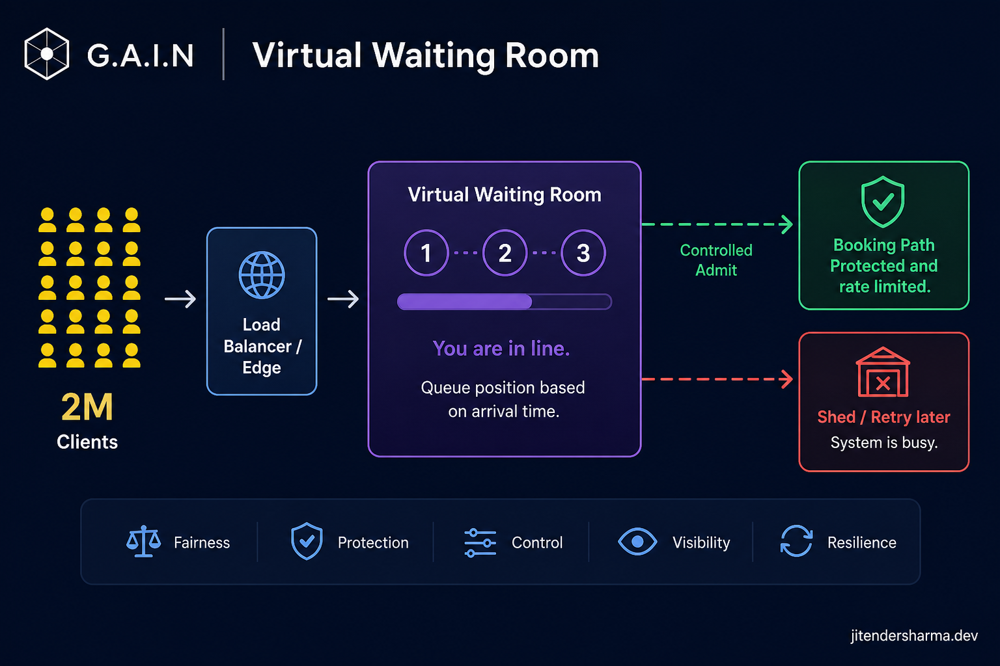
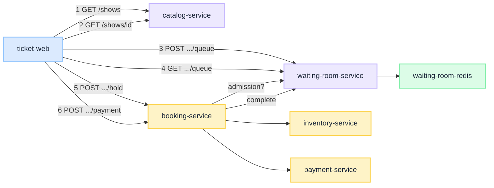

import Details from '@theme/Details';

<br/>


# Virtual Waiting Room: Absorbing the Open-Second Stampede

*When a concert on-sale or a limited ticket drop goes live, the product problem is not "make booking faster." It is "stop two million browsers from becoming two million concurrent writers against the same service."*

A load balancer spreads traffic. It does not invent capacity. If every client that lands on the VIP can call `POST /shows/{showId}/hold`, you still melt auth, booking, inventory, and payments in the same second. The virtual waiting room sits **in front of the book path**. The crowd gets a queue number. Only a controlled trickle may attempt a seat.

This is an **architecture breakdown** of waiting-room admission for open-second spikes. Exact vendor topologies differ (CDN waiting rooms, custom Redis rooms, Queue-it style products). The design lesson stays stable: **admit on your schedule, not theirs.** Sibling pieces: Active Token Concurrency (coming soon) and Redis Atomic Inventory (coming soon).

:::tip[THE CLAIM]
**A virtual waiting room is admission control, not inventory.** It turns an unbounded stampede into an ordered wait. It does not allocate seats, take payment, or prove fairness against bots. Those are later planes. If booking is reachable without passing the room, the room is decoration.
:::

**Full architecture:** [services, APIs, store keys, and the request path](/architecture/virtual-waiting-room-architecture)

<!-- truncate -->

## The simple picture

Think of a restaurant that seats 40 and a line of 2,000 people at the door.

| Piece | Restaurant | Open-second sale |
| --- | --- | --- |
| **Host stand** | Gives you a number, not a table | Waiting room |
| **Number** | "You are about #184" | Queue position |
| **Dining room** | Only 40 seats | Booking path (~2-3k concurrent) |
| **Full list** | "We're not taking more names" | Shed |

`ticket-web` calls `catalog-service` for the show, `waiting-room-service` for the line, and `booking-service` for hold and pay. Booking asks the room for admission.


<br/>

## Worked example: 2M arrivals, tiny useful work

| Quantity | Example | Why it matters |
| --- | --- | --- |
| Arrivals in first 60s | ~2,000,000 | Browsers + scripts |
| Scarce units | ~500-5,000 | On-sale quota or section drop |
| Safe concurrent bookers | ~2,000-3,000 | Downstream token pool |
| Status poll | 2-5s, jittered | Room reads only |
| Room hard cap | e.g. 500,000 waiters | Beyond this: shed |

Useful confirms will never approach 2M. The room's job is four things:

1. **Protect** booking from unbounded concurrency.
2. **Order** (or lottery) who gets promoted next.
3. **Communicate** progress without implying a reserved seat.
4. **Shed** when even waiting is unaffordable.

If 2M people enter an uncapped room, you moved the outage from Postgres to Redis and the polling fleet.

## Path at a glance

| # Stage | What it does | Failure if skipped |
| --- | --- | --- |
| **1. Catalogue** | List shows, open one show | Enter has no `showId` |
| **2. Enter the queue** | Button on the show page; sticky per userId | Refresh creates a new arrival |
| **3. Poll position** | Cheap "you are #N" reads | Every wait poll becomes a book attempt |
| **4. Admit or shed** | Promote the head, or reject when full | Infinite queue promises seats you will never sell |
| **5. Hand off** | Booking asks the room if the user is allowed | Hold writes inventory without the room |
| **6. Complete** | Booking tells the room; Redis drops the wait | A paid user holds a slot until TTL |

Nobody touches checkout until the room says so.

1. Client loads `GET /shows`, picks a show, opens `GET /shows/{showId}`.
2. **Enter the queue** on that page calls `POST /shows/{showId}/queue` on `waiting-room-service`.
3. Room assigns a queue number keyed by `userId` and `showId`.
4. Client polls `GET /shows/{showId}/queue` on the interval the server dictates (`pollAfterMs`), with jitter.
5. When the client calls `POST /shows/{showId}/hold`, `booking-service` asks `GET /shows/{showId}/admission`.
6. `POST /shows/{showId}/payment` is the same check. Booking asks admission, then `payment-service`.
7. After a successful charge, booking calls `DELETE /shows/{showId}/queue`. Room drops the wait, frees one admit slot, and the promoter can pull the next head. The arrival ticket does not rewind.

<Details summary="POST /shows/{showId}/queue (JSON)">

```json
{
  "request": {
    "method": "POST",
    "path": "/shows/sh_9k2/queue",
    "body": {}
  },
  "response": {
    "queueId": "q_184",
    "positionEstimate": 42131,
    "pollAfterMs": 10000,
    "state": "WAITING"
  }
}
```

</Details>

<Details summary="GET /shows/{showId}/queue (JSON)">

```json
{
  "request": {
    "method": "GET",
    "path": "/shows/sh_9k2/queue"
  },
  "response": {
    "queueId": "q_184",
    "state": "WAITING",
    "positionEstimate": 18420,
    "etaSeconds": 720,
    "pollAfterMs": 10000
  }
}
```

</Details>

Status must be cheap: short TTL cache per queueId, no inventory DECR, no payment, no heavy auth on every poll.

**Keep the same person in the same place.** `waiting-room-service` binds the queue entry to `userId`. One active wait per user per sale. If every refresh mints a new `queueId`, power users and bots jump the line.

**Do not lie in the UI.** Say "you are roughly #N." Do not say "your seats are held." Disable **Hold** until `GET /shows/{showId}/queue` returns `ADMITTED`. Keep polling after that. Honor `pollAfterMs`. Position is an estimate once you shard. Users tolerate "about 12 minutes" better than a frozen exact counter that jumps when shards rebalance.

## Who gets the next slot?

| Policy | How it works | Tradeoff |
| --- | --- | --- |
| **FIFO** | Lowest arrival ticket first | Feels fair; early bots win |
| **Lottery** | Random sample from waiters | Early join helps less |
| **Fair shard** | Cap per user or cohort, FIFO inside | Needs identity |
| **Hybrid** | FIFO with abuse penalties | Tunable; needs scoring |

Default I would defend: **authenticated FIFO with abuse demotion.** Lottery is the spike-simple fallback when identity is weak.

Promotion is driven by **downstream capacity**, not by "someone waited long enough." Sale start only enables `POST /shows/{showId}/queue`. A successful charge, a dead hold that booking reports, or an expire of an `ADMITTED` wait, frees a slot. The arrival ticket never rewinds.

## Redis holds the shared line

Every room replica needs the same ordering structure. Redis is a common choice: fast increments, TTLs, and cheap rank queries.

| Structure | Role |
| --- | --- |
| **Counter** | Arrival ticket (`INCR`) |
| **Sorted set** | Waiters scored by ticket (or lottery) |
| **Hash** | Session, userId, expiry, state |
| **Cursor** | How far promotion has advanced (for ETA) |
| **Admitted** | Occupied slots. `INCR` on promote, `DECR` on complete, hold expiry, or expire |

Do not put two million waiters in one giant list. Shard by `hash(userId) % N` or by sale section. Polls refresh membership TTL. A sweeper expires silence, `ZREM`s the waiter, and `DECR`s admitted if they were `ADMITTED`. Estimate position from `ticket - promotedCursor` instead of exact `ZRANK` across shards. Separate keys per `showId` so Event A cannot contend with Event B.

The product promise is "you are waiting in line," not "we recompute perfect worldwide FIFO on every heartbeat."

**Polling cost:** 500k waiters × 1 poll / 3s ≈ **167k RPS** of status reads. Keep status Redis-local or briefly edge-cached. No booking DB. No CAPTCHA on every poll. Far from the head, poll every 10s. Near the head, every 2s.

## Shed when the room is full

An unbounded waiting room is a denial-of-service sponge. It still burns Redis, the polling fleet, and goodwill. Cap it.

Beyond N waiters, return `SHED` / "sale busy, try again." Soft-degrade first if you want (slower polls, coarser position). Time-box the room to the sale window. Shed anonymous or high-risk waiters first if you can tell them apart.

Shedding is kinder than a silent hang. Size the cap from Redis memory and status RPS **before** the event, not during the outage.

**Fall closed on booking.** `booking-service` asks the room if the user is allowed. If the room is down, fail checkout. A closed sale with an apology beats an oversold inventory and a melted cluster. Refresh should keep the same place. A lost cookie should not mint a better ticket.

## What the waiting room does not solve

| Plane | Job |
| --- | --- |
| **Waiting room** | Who may wait / who may proceed next |
| **Active tokens** | How many users may hit hold/pay at once (coming soon) |
| **Atomic inventory** | Whether a seat lease succeeds, and whether it expires (coming soon) |
| **Abuse** | Bots, farms, multi-accounting |

A room without the next planes still lets admitted users stampede hold. A hold that expires returns seats on inventory. Booking then tells the room (`DELETE /shows/{showId}/queue`) so the admit slot opens. The room does not watch inventory itself. A room without abuse controls still fills with scripts that grabbed queue ids early.

**Queue position is not a seat.** #42,131 is a place in line for a chance to attempt booking. Messaging should never imply reserved inventory. Remaining tickets live on inventory. The room never reads them.

## Where I land

**Put the herd in a room before it can book.** For concert-class and ticket-drop-class spikes I would ship:

1. **booking-service asks waiting-room-service if the user is allowed** before hold or pay, and fall closed if the room is down.
2. **Pre-auth when possible**, one active wait per `userId` per sale, owned by the room.
3. **Sharded Redis zsets** plus a promoted cursor for ETA, not one mega-list.
4. **Hard cap + shed** sized from memory and poll RPS before the event.
5. **Admit rate tied to the downstream token pool**, not to wall-clock open alone.
6. Honest UX: position estimate, jittered polls, no "seat reserved" language.

FIFO with abuse demotion is the default ordering I would defend in a design review. Pure lottery is the fallback when identity is weak and bot pressure is extreme. The waiting room buys a controllable admission curve. Seats, money, and bot fairness start after booking confirms the user is allowed.
