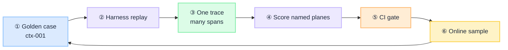

import Details from '@theme/Details';

# Golden Datasets: Building Eval Data That Predicts Production

A golden dataset is the **institutional memory** of what "good" looks like for your AI system. Without it, every eval conversation devolves into anecdotes. With a bad one, you optimize for the demo and fail in production.

Part of the [Eval Framework Blueprint](/blueprints/evaluation-blueprint) series.

:::tip[THE CLAIM]
**Golden datasets are versioned, plane-tagged, risk-tiered case libraries — not a one-time export of happy-path prompts.**
:::

<!-- truncate -->

## Five dataset layers (build all five)

| Layer | Purpose | Minimum size (per use case) |
| --- | --- | --- |
| **Representative** | Real user tasks | 50+ cases from prod sampling or domain workshops |
| **Edge** | Boundaries, ambiguity, multi-step | 20+ cases |
| **Adversarial** | Injection, misuse, policy bypass | 15+ cases |
| **Incident replay** | Every production failure | 1 case per incident, permanent |
| **Regression** | Locked baselines after each gate | Snapshot per release |

## Case schema

One case is one scored replay. The harness reads these fields. `expected` keys change by plane. This example is a Context case that also scores Outcome.

<Details summary="Golden dataset case schema (JSON)">

```json
{
  "id": "ctx-001",
  "version": "2026.07.1",
  "plane": ["context", "outcome"],
  "scenario": "representative",
  "risk_tier": "medium",
  "input": {
    "message": "What is our wire limit for tier-2 customers?",
    "principal": { "role": "advisor", "segment": "tier-2" }
  },
  "trace_fixture": "s3://eval-fixtures/ctx-001-trace.json",
  "expected": {
    "must_cite": ["policy-wire-limits-v3"],
    "must_not_cite": ["internal-draft-2024"],
    "abstain_if_missing_evidence": true
  },
  "rubric_dims": ["grounding", "scope", "completeness"],
  "automated": {
    "citation_required": true,
    "max_latency_ms": 8000
  },
  "failure_class": null,
  "owner": "product-banking",
  "source": "production_replay"
}
```

</Details>

### Field definitions

| Field | What it is |
| --- | --- |
| `id` | Stable case key. Do not reuse after you retire it. Prefix by primary plane (`ctx-001`). |
| `version` | Dataset pin this case belongs to (`2026.07.1`). Bump when any case is added, edited, or removed. |
| `plane` | Which request-path stages this case scores. See [Plane tagging](#plane-tagging). One case can list several. |
| `scenario` | Which of the [five layers](#five-dataset-layers-build-all-five) this case belongs to: `representative`, `edge`, `adversarial`, `incident_replay`, or `regression`. |
| `risk_tier` | `low`, `medium`, or `high`. High-risk cases go to human review even if the judge passes. |
| `input` | What you replay into the system for this case. |
| `input.message` | User utterance (or the equivalent request) to replay. |
| `input.principal` | Who is asking. Role and segment that PDP, ACL, and retrieval must see. |
| `input.principal.role` | Entitlement class (`advisor`). Wrong role is a different case, not a comment. |
| `input.principal.segment` | Customer or book segment (`tier-2`). Limits and policies often split here. |
| `trace_fixture` | URI of the saved span file for this case (S3, GCS, or git LFS). The case JSON stays small. See [trace_fixture, rubric_dims, automated](#trace_fixture-rubric_dims-automated). |
| `expected` | Deterministic assertions the harness can pass or fail without a judge. Keys vary by plane. |
| `expected.must_cite` | Context/Outcome: document IDs that must appear as citations. |
| `expected.must_not_cite` | Document IDs that must never appear (drafts, other tenant, off-policy). |
| `expected.abstain_if_missing_evidence` | If required evidence is missing, the system must refuse. Guessing is a fail. |
| `rubric_dims` | Names of the 1-5 scales a judge or human scores. Not pass/fail lists. |
| `automated` | Machine checks. No judge. Fail closed if any is false. |
| `automated.citation_required` | Answer has no citation: fail, even if the number looks right. |
| `automated.max_latency_ms` | End-to-end path slower than this: fail, even if quality passed. |
| `failure_class` | `null` until the case is an incident or a scored fail. Then a label from that plane's failure taxonomy (for Context: retrieval failure, over-retrieval, scope leak). |
| `owner` | Team that maintains `expected` and `rubric_dims` for this case. |
| `source` | How the case entered the library: `production_replay`, `synthetic`, `manual`, or `user_feedback`. |
| `replaces` | Optional. When you supersede a case that already gated a release, point at the old `id` instead of editing it in place. |

Context `expected` uses citations (`must_cite`). [Data](/playbooks/evaluation/plane-data) uses source versions and forbidden doc IDs. [Action](/playbooks/evaluation/plane-action) uses PDP verdicts. Do not copy this Context example onto every plane.

### trace_fixture, rubric_dims, automated

These three are easy to collapse into "the answer." They are not.

**`trace_fixture`** is a pointer, not the test. `"s3://eval-fixtures/ctx-001-trace.json"` is where the saved spans live: retrieval pack, model hop, response. The case file stays small. The fixture is the recorded hops for this case (usually the production or workshop turn you labeled). Humans and the judge open it so they see the pack, not only the sentence. CI still **replays** `input` on the current build and writes a **new** live trace. It scores that live trace against `expected`. The fixture is the original evidence and the incident record, not a substitute for replay. Shape of the file: [One trace, many spans](#one-trace-many-spans). Incident cases must have one.

**`rubric_dims`** is the qualitative scorecard. `["grounding", "scope", "completeness"]` means a judge or human gives each a 1-5, using the same names as the plane rubric ([Human review](/playbooks/evaluation/human-review), [LLM-as-judge](/playbooks/evaluation/llm-as-judge)). On this case:

| Dimension | Question |
| --- | --- |
| `grounding` | Is every claim supported by a cited chunk (v3, not memory)? |
| `scope` | Did it stay on entitled, on-policy material (no draft, no other book)? |
| `completeness` | Did it answer the wire-limit question, including the daily $50,000? |

These are not the same as `expected.must_cite`. A case can have v3 in the pack (Context pass) and still score `grounding: 2` if the sentence invents $250,000.

**`automated`** is the cheap gate. No LLM. Boolean or threshold only.

| Key | On this case | Fail when |
| --- | --- | --- |
| `citation_required: true` | The answer must cite something | Fluent $50,000 with no citation |
| `max_latency_ms: 8000` | The scored path must finish in 8s | Right answer, 12s |

Run automated first. If it fails, skip the judge. Policy and latency do not wait for a 1-5.

## Plane tagging

A **plane** is a stage on the request path that can fail on its own. The catalog is **fixed**: eight names, not a new plane per hop. Input, Data, Context, Reasoning, Tool, Memory, Action, Outcome. Full recipes: [Eval planes](/playbooks/evaluation#eval-planes-at-a-glance). A reranker or validator still lands on one of these eight. You change the framework if you need a ninth.

**Plane-tagged** means the case lists a **subset** of those eight in `plane`. The example is `"plane": ["context", "outcome"]`. The harness replays once, then scores only those planes. Context: did the right evidence arrive? Outcome: did the user get a complete, citable answer? Two results, not one accuracy score.

One case often lists more than one plane. That is correct. A wrong wire-limit answer can be stale Data, a Context miss, or an Action deny. Tags decide which gates run. Without tags, CI goes green while retrieval is broken, because only the final sentence was scored.

| Tag | Stage it scores | When to include |
| --- | --- | --- |
| `input` | Before inference | Injection, malformed input, PII |
| `data` | Corpus and index | Stale source, wrong catalog version |
| `context` | What reached the model | Retrieval scope, ranking, abstention |
| `reasoning` | Plan and synthesis | Multi-hop logic, tool selection |
| `tool` | The call itself | API args, error handling |
| `memory` | Across turns | Cross-turn state, session bleed |
| `action` | Side effects | Policy, authorization, writes |
| `outcome` | What the user sees | End-user task completion |

## Worked use case: tier-2 wire limit

This is the case in the schema above, as a real turn.

**The situation.** An advisor is in the banking assistant with a tier-2 customer on the line. They type: "What is our wire limit for tier-2 customers?" Published policy v3 says **$50,000 daily**. An internal draft from 2024 says $250,000. That draft must never reach a customer answer.

**What you store.** One golden case, `ctx-001`. You do not store "the chatbot should be accurate." You store the replay and the assertions:

<Details summary="ctx-001 test case (JSON)">

```json
{
  "id": "ctx-001",
  "version": "2026.07.1",
  "plane": ["context", "outcome"],
  "scenario": "representative",
  "risk_tier": "medium",
  "input": {
    "message": "What is our wire limit for tier-2 customers?",
    "principal": { "role": "advisor", "segment": "tier-2" }
  },
  "trace_fixture": "s3://eval-fixtures/ctx-001-trace.json",
  "expected": {
    "must_cite": ["policy-wire-limits-v3"],
    "must_not_cite": ["internal-draft-2024"],
    "abstain_if_missing_evidence": true
  },
  "rubric_dims": ["grounding", "scope", "completeness"],
  "automated": {
    "citation_required": true,
    "max_latency_ms": 8000
  },
  "failure_class": null,
  "owner": "product-banking",
  "source": "production_replay"
}
```

</Details>

| In the case | In this turn |
| --- | --- |
| `input.message` | The advisor's question |
| `input.principal` | Role `advisor`, segment `tier-2` (a teller, or a tier-1 book, is a different case) |
| `trace_fixture` | The stored pack: which chunks were retrieved, what the model said, which docs it cited |
| `plane` | `context` and `outcome` only. This case does not claim to prove the index is fresh. That is a Data case. |
| `expected.must_cite` | `policy-wire-limits-v3` |
| `expected.must_not_cite` | `internal-draft-2024` |
| `expected.abstain_if_missing_evidence` | If v3 is not in the pack, refuse. Do not guess $50,000 from memory. |
| `automated.citation_required` | No citation, fail |
| `rubric_dims` | `grounding`, `scope`, `completeness` |

**A passing replay.** Retrieval puts v3 in the pack, not the draft. The answer is: "Tier-2 daily wire limit is $50,000 (policy-wire-limits-v3)." Context passes (right evidence, no leak). Outcome passes (complete, cited, no invented number).

**The same question, three different fails.** One user-visible miss, three plane stories. That is why the case is tagged.

| What the user saw | Which plane fails | Why |
| --- | --- | --- |
| "$50,000" but the pack was the 2024 draft | **Context** | Wrong evidence. Outcome can still *sound* right. Untagged, CI calls this a pass. |
| Cites v3, writes "$250,000" | **Outcome** | Evidence was fine. The sentence is not. Context would pass. |
| Cites v2 after a policy publish | **Data** (not this case) | Index is stale. Add a Data-tagged case with `source_versions: ["v3"]`. Do not stretch `ctx-001` to cover it. |

**What CI records.** Two rows from one replay, not one accuracy number.

<Details summary="ctx-001 score record (JSON)">

```json
{
  "case_id": "ctx-001",
  "dataset_version": "2026.07.1",
  "system_version": "assistant-2026.11.3",
  "planes": {
    "context": { "verdict": "PASS", "must_cite": true, "must_not_cite": true },
    "outcome": { "verdict": "PASS", "grounding": 5, "scope": 5, "completeness": 4 }
  },
  "gate": "PASS"
}
```

</Details>

A Context fail on this case blocks the release even if Outcome still reads fluently.

## How it works end to end

A change hits CI. The harness asks the same advisor question again. It checks the stages the case named. Either fail blocks the ship. After release you sample live traffic. Real misses become new cases.


<br/>

1. **Freeze the case.** `ctx-001` plus `expected`. Dataset pin `2026.07.1`.
2. **Replay on every change.** Same `input.message` and `input.principal` through the current build. Not a "just the LLM" shortcut.
3. **Read the live trace.** Automated checks first: citation present, v3 in the pack, draft absent, latency under budget.
4. **Score only named planes.** Context from the retrieval span. Outcome from the response span. Medium risk can use a calibrated judge. High risk goes to a human.
5. **Gate.** Two verdicts, one `PASS` / `FAIL`. Store `(dataset_version, system_version, scores)`.
6. **Promote back.** Sample production. Drift or an incident becomes a new case within 7 days. Do not edit `ctx-001` in place after it gated a release. See [Online & Dynamic Eval](/playbooks/evaluation/online-dynamic).

## One trace, many spans

Ten intermediate components are **ten spans on one trace**, not ten traces. One `trace_id` at the gateway. Each hop writes a span. The harness opens that trace and compares **named** spans to `expected`.

**How it picks a span.** `plane` on the case plus `gain.plane` on the span. `ctx-001` asks for Context and Outcome. The harness does not walk every span hoping something looks right.

| Case `plane` | Span it reads | What it compares |
| --- | --- | --- |
| `context` | `kind: retrieval` (`gain.plane: context`) | `retrieved_chunks` vs `must_cite` / `must_not_cite` / abstain |
| `outcome` | `kind: response` (`gain.plane: outcome`) | Answer text and citations vs rubric |
| `tool` | **Every** `gain.plane: tool` span, in order | Each call vs `expected.tools[]` |

Context is a **list check on the pack**, not English on the sentence. "$50,000" with the draft in `retrieved_chunks` fails Context even if Outcome sounds right. If the app never writes the pack onto the trace, Context cannot be scored. You only have the sentence.

<Details summary="ctx-001 replay trace (JSON)">

```json
{
  "trace_id": "tr_ctx_001_replay",
  "case_id": "ctx-001",
  "spans": [
    {
      "span_id": "s1",
      "kind": "gateway",
      "gain.plane": "input",
      "attrs": {
        "message": "What is our wire limit for tier-2 customers?",
        "principal": { "role": "advisor", "segment": "tier-2" }
      }
    },
    {
      "span_id": "s2",
      "parent_id": "s1",
      "kind": "retrieval",
      "gain.plane": "context",
      "attrs": {
        "retrieved_chunks": [
          { "doc_id": "policy-wire-limits-v3", "rank": 1, "score": 0.91 },
          { "doc_id": "policy-fees-v3", "rank": 2, "score": 0.62 }
        ],
        "ranker_version": "rrf-2",
        "pack_token_count": 840,
        "abstention_reason": null
      }
    },
    {
      "span_id": "s3",
      "parent_id": "s2",
      "kind": "model",
      "gain.plane": "reasoning",
      "attrs": {
        "model_id": "assistant-2026.11.3",
        "citations": ["policy-wire-limits-v3"]
      }
    },
    {
      "span_id": "s4",
      "parent_id": "s3",
      "kind": "response",
      "gain.plane": "outcome",
      "attrs": {
        "answer": "Tier-2 daily wire limit is $50,000 (policy-wire-limits-v3).",
        "cited": ["policy-wire-limits-v3"]
      }
    }
  ]
}
```

</Details>

On this replay the harness scores `s2` for Context and `s4` for Outcome. It does not use `s1` or `s3` for those two checks. If retrieval never emits `gain.plane: context`, Context fails closed.

### Several tool calls

Still one trace. Each tool call is its own span, all `gain.plane: "tool"`. The case lists the expected sequence. A third surprise tool is a fail, not a new plane. Recipe: [Tool plane](/playbooks/evaluation/plane-tool).

<Details summary="Tool-tagged case when two tools run (JSON)">

```json
{
  "id": "tool-014",
  "version": "2026.07.1",
  "plane": ["tool", "action", "outcome"],
  "scenario": "representative",
  "risk_tier": "high",
  "input": {
    "message": "Send $500 AUD to VND-ACME from ACC-4821",
    "principal": { "role": "advisor", "segment": "tier-2" }
  },
  "expected": {
    "tools": [
      { "tool": "get_account", "arguments": { "account_id": "ACC-4821" } },
      { "tool": "initiate_wire", "arguments": { "amount": 500, "currency": "AUD" } }
    ]
  },
  "failure_class": null,
  "owner": "product-banking",
  "source": "manual"
}
```

</Details>

Two tools, two spans, one `trace_id`. Checks: in manifest, args match schema, `get_account` before `initiate_wire`.

## How to populate each layer

### Representative tasks
- Sample production traffic (redacted, consented) into a review queue
- Domain experts label: task type, success criteria, risk tier
- Promote to golden set after human confirms expected behavior

### Edge cases
- Workshop with support and compliance: "what almost went wrong?"
- Boundary values: empty retrieval, max context, concurrent tools, timeout paths

### Adversarial cases
- Prompt injection in user and retrieved content
- Tool argument manipulation
- Requests for out-of-scope data
- Jailbreak patterns relevant to your domain (not generic internet lists)

### Incident replay
- **SLA: incident → golden case within 7 days**
- Store full trace fixture, not just final Q&A
- Tag `failure_class` from the taxonomy in the [Eval Blueprint](/blueprints/evaluation-blueprint) and the matching plane playbook

## Versioning and change control

- Dataset version bumps on **any** case add/edit/remove
- CI runs eval against `dataset@version` + `system@build`
- Store `(dataset_version, system_version, scores)` for audit replay
- Never edit a case in place after it gates a release — append a new case or supersede with `replaces: "ctx-001"`

## Splitting datasets for judge calibration

| Split | Use |
| --- | --- |
| **Calibration (15%)** | Tune LLM-as-judge against human scores |
| **Holdout (15%)** | Final judge validation — never tune on this |
| **Gate (70%)** | CI/CD release gate |

## Anti-patterns

| Anti-pattern | Why it fails |
| --- | --- |
| Single "accuracy" label per case | Hides which plane broke |
| Invent a ninth plane per hop | Harness cannot bind `gain.plane` to a case tag |
| Score Context from the final sentence | Pack never inspected; draft-in-pack looks like a pass |
| One tool span for many calls | Sequence and surprise tools disappear |
| Copy-paste from public benchmarks | Domain and policy mismatch |
| No adversarial layer | Production surprises are guaranteed |
| Stale dataset (>90 days, no replay) | Drift makes scores meaningless |
| Editing cases to make CI green | You are lying to the gate |

## Next in series

- [Synthetic Generation](/playbooks/evaluation/synthetic-generation) — scale edge & adversarial layers
- [Online & Dynamic Eval](/playbooks/evaluation/online-dynamic) — production sampling & drift
- [Human Review](/playbooks/evaluation/human-review) — score cases humans own
- [LLM-as-Judge](/playbooks/evaluation/llm-as-judge) — scale scoring with calibration
- [Eval Framework Blueprint](/blueprints/evaluation-blueprint) — full architecture
- [Context plane](/playbooks/evaluation/plane-context): pack fields the retrieval span must emit
- [Tool plane](/playbooks/evaluation/plane-tool): per-call tool spans
